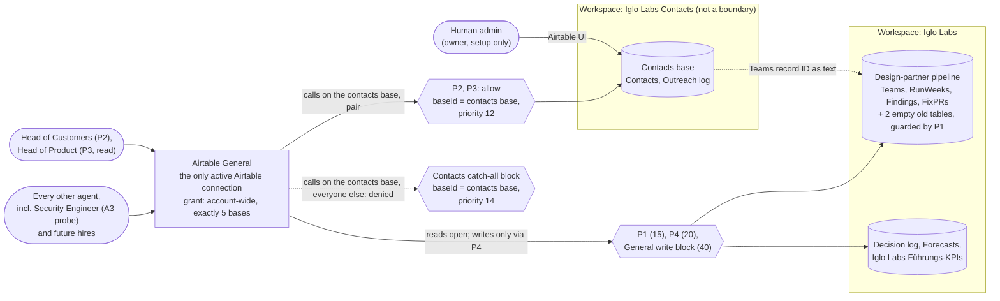

# ADR-008: Airtable access boundary for personal data

Status: accepted, revision 3. Takes effect at the wave 1 trigger. Until T5 passes, D-2026-11-01-01 applies to everything outside this decision. Revision 3 is in force when the Head of Tech merges it.
Date: 2026-10-31, updated 2026-11-01 (board decision on O1; CEO deferral D-2026-11-01-01; boundary design from IGL-71, revision 4; revision 2 of this ADR: single connection, decided in IGL-71 design revision 5, applied state from revision 6; **revision 3: the boundary covers every derived copy, decided by the Head of Tech on IGL-111**)
Owner: Architekt
Approver: Head of Tech
Issues: [IGL-55](/IGL/issues/IGL-55) (first version), [IGL-74](/IGL/issues/IGL-74) (revision 1), [IGL-83](/IGL/issues/IGL-83) (revision 2), [IGL-114](/IGL/issues/IGL-114) (revision 3, this one). Source of revision 3: the Head of Tech decision on [IGL-111](/IGL/issues/IGL-111) (2026-11-01, 16:25 UTC). Source of the decision: [IGL-71 design document](/IGL/issues/IGL-71#document-design), **revision 6** (2026-11-01, 13:25 UTC). Revision 6 has the same decision as revision 5 (13:05 UTC) and adds the applied state from step T3. The design revises the [IGL-51 decision](/IGL/issues/IGL-51#document-decision), decisions 1 to 3 and update 4. The reasons for the single connection are in design section 0a.

## Where the live identifiers are

This repository is public. This ADR records the decision and the rules. It does not record live identifiers: Airtable base, table and workspace IDs, Paperclip connection, agent and policy IDs, or the current state of each trigger step. Those are on [IGL-71](/IGL/issues/IGL-71#document-design), which is internal:

- connection, base, table and workspace IDs: design sections 0 to 2;
- agent IDs: design section 3;
- policy IDs, mapped to the policy names used below: design section 4;
- verified current state and trigger progress: design sections 0 and 7;
- the state of the derived-copy controls (Decision section 8) and the re-test result: [IGL-111](/IGL/issues/IGL-111) and its child tasks.

Names used in this ADR: **General** (the shared Airtable connection, the only active one), **pipeline base**, **contacts base** (`appK` in the design), **"Iglo Labs"** and **"Iglo Labs Contacts"** (the two Airtable workspaces), **the archived contacts connection** (the old shared connection, archived since 2026-11-01). **`C`** appears only in the history sections: it was the planned contacts connection of revision 1 and was never created.

Keep live identifiers out of this file and out of the PR. Add them on IGL-71.

## Current state

**CEO decision D-2026-11-01-01** (2026-11-01, on [IGL-62](/IGL/issues/IGL-62) and [IGL-51](/IGL/issues/IGL-51)): every agent has full access to every Airtable base until real customer data is in Airtable. It holds for everything outside this decision until T5 passes. Nobody writes a contact record before then.

The trigger was flagged on 2026-11-01 (T0), so the [Trigger sequence](#trigger-sequence) is running. Wave 1 is planned for 2026-11-23. The verified state and the progress of each step are tracked on [IGL-71](/IGL/issues/IGL-71#document-design) (sections 0 and 7), not here.

**Head of Tech decision on IGL-111** (2026-11-01): the contacts boundary covers every copy of what an agent read, not only Airtable tool calls. No contact record goes into `Contacts` or `Outreach log` until controls C1 to C3 in [Decision section 8](#8-the-boundary-covers-every-derived-copy) are in place and D1 to D4 pass. The progress is tracked on IGL-111, not here.

## Context

The design-partner pipeline (the pipeline base, built in IGL-36) will need personal data: contacts and an outreach log. The [IGL-42 security review](/IGL/issues/IGL-42#document-security-review) found:

- **F1 (high):** every agent on the shared Airtable connection acts as workspace owner. Any agent can read, export, change or delete every table, contacts included, and can create public share links. Airtable has no per-table read limit inside a base.
- **F2 (high):** the plan, the collaborators and the share links are not known, because the connection cannot show them.

Both must be fixed before the first contact record (IGL-42 section 5, conditions 2 and 3).

Constraints:

- **One shared connection for general work.** The board ruled on IGL-30 (2026-10-31) that Airtable runs through one shared company connection in Paperclip, not one token per agent.
- **What the token can reach.** An Airtable OAuth token acts as the user who granted it, limited by scopes and by the bases or workspaces picked at authorization ([OAuth reference, "Token permissions"](https://airtable.com/developers/web/api/oauth-reference); [help: third-party integrations via OAuth](https://support.airtable.com/articles/6811769763-third-party-integrations-via-oauth-overview); both read 2026-10-31 by the Head of Tech). The granting user's workspace role is the ceiling.
- **The OAuth grant carries write scopes** `schema.bases:write` and `data.records:write` (accepted in IGL-51 update 2). The policies limit what agents can do.

### What revision 2 is based on (IGL-71 design section 0a)

Verified by the Head of Tech with read-only calls on 2026-11-01:

1. **General's grant is account-wide, including new workspaces.** General was last consented at 11:52 UTC. The workspace "Iglo Labs Contacts" and the contacts base were created around 12:31 UTC, and General saw both at 12:35 UTC without any new consent. Any base a human creates is visible to General at once. A consent mistake is ruled out as the cause.
2. **A per-workspace re-consent of General is not confirmed to exist.** The card for that human step (T2b in revision 1) was dismissed at 12:47 UTC without a reason, and the Airtable documentation could not be checked. The Head of Tech does not ask again.
3. **`C` was never created.** The old contacts connection is archived, and no other Airtable connection exists. A separate connection would need a new human OAuth step, and nothing shows that its consent screen would limit it to one base.
4. **`baseId` is a reliable policy key.** Every Airtable tool that reads or writes data inside a base **requires** `baseId` with schema `pattern: ^app[A-Za-z0-9]{14}$`. This covers the record, table, schema, comment, page, form, automation and revert tools. A base name is not accepted. The 12 tools without `baseId` are `list_workspaces`, `list_bases`, `search_bases`, `ping`, `list_secrets`, `list_external_accounts`, `fetch_automation_input_data`, `get_create_automation_instructions`, `describe_page_element`, `describe_page_type`, `get_custom_element_documentation` (none of them return base data) and `create_base` (Off-list, takes `workspaceId`).

Design revisions 5 and 6 list 9 of these. The QA review of PR #10 found the other 3 (`describe_page_element`, `describe_page_type`, `get_custom_element_documentation`), and the Architekt confirmed them in the tool schemas on 2026-11-01. They take only `elementType`, `pageType` or `topics` and return static JSON schemas or SDK documentation, not base data. The Head of Tech confirms this classification on IGL-71 and updates A8 in design section 6, which still says 9.

Revision 1 said that argument matching is "a guard, not a boundary". That was about `tableId`, which read tools also accept as a table name. It does not apply to `baseId`.

### How the Paperclip policy engine decides

Read in source by the Head of Tech: `server/src/services/tool-access-policy.ts`, `decide()`, upstream commit `b43073d11`.

1. Enabled policies are evaluated in ascending `priority`, then `createdAt`. **The first matching policy returns.** `block` denies, `require_approval` asks, `allow` allows before gateway profiles are consulted.
2. **Actor conditions can only list agents** (`agentId(s)`, `actorType(s)`). There is no "everyone except" form. A block policy with an agent list is a deny list, and every new hire slips past it.
3. **Policies can match tool arguments** (`conditions.arguments.fieldIn`, `fieldEquals`, `fieldMatches`). This corrects IGL-51 update 4, which said a block policy cannot match a base or table.
4. **Installs and native gateway profiles are not a boundary.** Every agent gets a profile that lists all tools of a connection, and profiles cannot deny. This was found on 2026-11-01 in the first IGL-63 run.

The source tree may differ from the deployed server. Assertions A3 to A6 prove the behaviour live.

**Answered at T3: an `arguments` condition does not match a call that lacks the argument.** Agent-Ops reported this on IGL-71 at 13:16 UTC, and the Head of Tech confirmed it at 13:22 UTC (design revision 6). So the base-less tools are not affected by the contacts policies. The security consequence is in [Decision section 7](#7-one-layer-instead-of-two): a call that leaves out `baseId` is not matched by the contacts catch-all block.

## Options

### Where contacts live

- **A: separate contacts base.** Contacts and Outreach log go into their own base. The pipeline base keeps Teams, RunWeeks, Findings and FixPRs. The link is the Teams record ID as plain text.
- **B: one base, lower-role connection.** All tables in one base. Agents that do not need contacts use a second connection that belongs to an Airtable user with a lower role. Field and table edit permissions (paid plans) restrict writes, not reads.
- **Do nothing.** One base, one owner-level connection. Rely on the rule in `tools-and-data.md` that each agent only touches its own tables.

### How agents reach the contacts base

- **K1: second connection `C`, limited to the contacts base** (revision 1, superseded). Two layers: the OAuth grant keeps General away from the contacts base, and an allow-list on `C` limits who uses it.
- **K2: General only, policies keyed on `baseId`** (revision 2, chosen). One layer: allow policies for the pair, then a catch-all block on every call whose `baseId` is the contacts base.

### How the policies are written

- **E1: deny list** (the first, deferred design). The block lists every agent except Head of Customers and Head of Product. Each new hire must be added.
- **E2: allow-list, then a catch-all block with no actor condition.** Allow policies name the agents. A block with no actor condition comes after them and catches everyone else.
- **E3: argument match.** Block calls whose arguments name the contacts base or tables.

## Evaluation

The template weights are changed for this ADR. It is an access decision, not a technology choice: security posture and the board ruling decide it, and performance is not a factor at our volume. Data integrity is added because option A breaks a linked-record field.

| Criterion | Weight | A: separate base | B: lower-role connection | Do nothing |
| --- | --- | --- | --- | --- |
| Security posture | 35% | 4 | 2 | 1 |
| Fit with the IGL-30 ruling | 20% | 5 | 1 | 5 |
| Agent fit | 15% | 4 | 4 | 5 |
| Cost of ownership | 15% | 4 | 3 | 5 |
| Data integrity | 10% | 3 | 5 | 5 |
| Lock-in risk | 5% | 3 | 3 | 3 |
| Weighted total | | **4.05** | 2.60 | 3.50 |

Revision 2 changes three scores for A. Security posture goes from 5 to 4, because Airtable no longer keeps General away from the contacts base and the policies are the only layer. Fit with IGL-30 goes from 4 to 5, and cost of ownership from 3 to 4, because there is no second connection. The total stays 4.05.

- Security posture: A gives the contacts a base of their own, so the contacts base ID marks them. Every tool that reaches base data requires that ID in `app…` form, so a policy can fence the base completely. In one base (B or Do nothing), the only key would be `tableId`, and read tools accept a table *name*, so a policy on IDs can be bypassed. B also lets every agent on the lower-role connection *read* contacts, because Airtable cannot hide a table inside a base. Do nothing leaves F1 open.
- Fit with IGL-30: A now runs on the one shared connection with no exception. B is a second connection for the general case, which the board ruled against.
- Agent fit: in A, agents work with a Teams record ID across two bases, a simple and common pattern.
- Cost of ownership: A adds a base and a workspace. B adds a second connection and maybe a paid seat.
- Data integrity: in A the Team key is plain text, so Airtable does not stop a wrong or orphaned key.

Do nothing scores second only because it costs nothing, and it fails a hard condition: IGL-42 section 5 does not allow personal data in a reachable base while F1 is open.

How agents reach the contacts base:

| | K1: second connection `C` | K2: General with `baseId` policies (chosen) |
| --- | --- | --- |
| Layers | 2: OAuth grant + policies | **1: policies only** |
| What the first layer needs | General's grant must exclude the contacts base. Shown to be impossible as things stand: the grant is account-wide (0a point 1), and a per-workspace re-consent is not confirmed to exist (point 2) | nothing outside Paperclip |
| Human steps | new OAuth consent for `C`, re-consent of General (T2b) | none |
| State on 2026-11-01 | `C` never created; T2b card dismissed | can be applied at T3 |
| Key the policies use | the connection | `baseId`, required in `app…` form by every tool that reaches base data (0a point 4) |

K1 only adds a layer if General can be kept out of the contacts base, and the evidence says it cannot. K2 needs no human step and uses a key that the tool schemas enforce. The cost is one layer instead of two (see [Decision section 7](#7-one-layer-instead-of-two)).

How the policies are written, compared on the one property that decides it, which is what happens to an agent nobody thought of:

| | E1: deny list | E2: allow-list + catch-all block | E3: argument match |
| --- | --- | --- | --- |
| New hire | **gets full access** until someone adds them | denied by default | depends on the argument |
| Happened already | yes: Reviewer Terra (now Reviewer Sol) and Reviewer Opus were hired after the policies and are in neither deny list | no | not used |
| Weakness | needs a step at every hire, and the step was missed | none found for this case | on `tableId`: read tools accept table names, so a match on IDs can be bypassed. On `baseId`: none found, because the ID form is required |

E1 would have given both reviewers full access to contacts if the old policies had been re-enabled as they are. Revision 2 combines E2 and E3: the allow-list and the catch-all block are both conditioned on `baseId` = the contacts base. The `tableId` match stays a guard only (P1).

## Decision

**Option A, reached through General only (K2), with enforcement E2 keyed on `baseId`.** Decided by the Head of Tech on [IGL-71](/IGL/issues/IGL-71#document-design), revision 5; applied state in revision 6. Applies from the trigger.

### 1. Bases and workspaces

- **"Design-partner pipeline"** (the pipeline base) keeps Teams, RunWeeks, Findings, FixPRs. No names of people.
- **The contacts base** was created empty by the human at T2, in the workspace "Iglo Labs Contacts". It holds `Contacts` and `Outreach log`, with the same fields as the two empty tables in the pipeline base. The link to a team is the Teams record ID as plain text. No linked-record field crosses bases. Airtable's default first table may be reused or left empty. Its AI field `Attachment Summary` is not used for contacts.
- **Renaming the contacts base** to "Design-partner contacts" is optional and not a gate. No agent tool can do it, so only a human can, in the Airtable UI. The ID stays the same.
- **The contacts base must not be duplicated or moved.** A copy gets a new ID and falls outside every policy in section 4. A1 fails on a sixth base.
- **The separate workspace is not a boundary.** General reaches it like every other workspace. It is kept because it exists and costs nothing.
- **Head of Customers builds the tables** through General, under the temporary schema allow P0. Agent-Ops deletes P0 after the build and before the first record.

### 2. Connection and the bases it reaches

| Connection | Bases it reaches (exact set) | Who may touch the contacts base |
| --- | --- | --- |
| Airtable General, the only active Airtable connection | exactly 5: Decision log, Forecasts, Iglo Labs Führungs-KPIs, Design-partner pipeline (in "Iglo Labs"), and the contacts base (in "Iglo Labs Contacts") | Head of Customers and Head of Product only (section 3), enforced in section 4 |

The archived contacts connection stays archived. Agent-Ops removes it from every policy's connection list at T3.

- **A base that shows up in General and is not on this list is a failure.** It passes only after the Head of Tech adds it to this table. That is how new bases get reviewed.
- **There is exactly 1 active Airtable connection.** A second active Airtable connection is a failure (A9) until the Head of Tech adds it here.

### 3. Agents on the contacts base

| Agent | On the contacts base |
| --- | --- |
| Head of Customers | the 10 base-scoped read tools, plus `create_records_for_table`, `update_records_for_table`, `create_record_comment`. `delete_records_for_table`: ask first. Nothing else. |
| Head of Product | the 10 base-scoped read tools only |
| Every other agent, **including the Security Engineer and every future hire** | every tool call that names the contacts base is denied |

Board answer of 2026-11-01 (O1, below). The Security Engineer gets no access (IGL-51 update 2). Their own denied call is the proof (A3). They already have General, so A3 runs as a live probe on every weekly run with no special install.

**The 10 base-scoped read tools** (all take `baseId`): `analyze_table`, `get_record_for_page`, `get_table_schema`, `list_record_comments`, `list_records_for_page`, `list_records_for_table`, `list_tables_for_base`, `list_views_for_table`, `search_candidate_linked_records`, `search_records`.

**The 4 base-less read tools** (`list_bases`, `list_workspaces`, `search_bases`, `ping`) are not in the contacts policies. They work for every agent as today. They show the contacts base's name and ID, never its records. Accepted (IGL-71 section 8).

### 4. Policies

All on General only. The archived contacts connection is removed from every connection list.

Access to the contacts base is an **allow-list followed by a catch-all block with no actor condition**, both conditioned on `baseId` = the contacts base ID. Because the first match wins, an agent that no allow policy names falls through to the block. New hires are denied by default. The same pattern applies to record writes on the other bases.

Five existing policies are reused, named here by role. Two of them, the contacts delete ask-first and the contacts catch-all block, are repurposed for the contacts base. Their IDs, and the agent IDs, are on IGL-71 (design section 4).

| Priority | Policy | Type | Tools | Actor | Condition | Change at trigger |
| --- | --- | --- | --- | --- | --- | --- |
| 5 | **P0**, new, temporary | allow | `create_table`, `create_field`, `update_field`, `update_table` | Head of Customers | `baseId` = contacts base | create at T4, **delete before the first record** |
| 10 | Off-list block (existing) | block | the 36 Off tools, unchanged | none (everyone) | none | remove the archived connection; priority 10; enable |
| 12 | **P2**, new | allow | 10 base-scoped read tools + `create_records_for_table`, `update_records_for_table`, `create_record_comment` | Head of Customers | `baseId` = contacts base | create |
| 12 | **P3**, new | allow | 10 base-scoped read tools | Head of Product | `baseId` = contacts base | create |
| 13 | Contacts delete ask-first (existing, repurposed) | require_approval | `delete_records_for_table` | Head of Customers | `baseId` = contacts base | rebind from the archived connection to General; add the condition; priority 13; enable |
| 14 | **Contacts catch-all block** (existing, repurposed) | block | **all** (no tool selector) | **none** (delete the agent list) | `baseId` = contacts base | rebind from the archived connection to General; delete the actor condition; add the condition; priority 14; enable |
| 15 | **P1**, new: guard on the old tables | block | `create_records_for_table`, `update_records_for_table` | none | `tableId` in the IDs of the 2 old tables | create |
| 20 | **P4**, new | allow | `create_records_for_table`, `update_records_for_table`, `create_record_comment`, `revert_action` | Chief of Staff, Prognostiker, Head of Customers, Head of Marketing | none | create (same 4 writers as today) |
| 30 | General delete ask-first (existing) | require_approval | `delete_records_for_table` | the same 4 writers | none | priority 30; enable |
| 40 | General write block (existing) | block | the 5 record write tools | **none** (delete the agent list) | none | remove the archived connection; delete the actor condition; priority 40; enable |

The existing ask-first policy for `analyze_table` (priority 50) is not used and stays disabled. A8 checks it.

**Condition form (as applied at T3, deliberate).**

- **The allows (P0, P2, P3) and the contacts delete ask-first** use `fieldEquals` on `baseId` with the contacts base ID. They are exact-case.
- **The contacts catch-all block** uses `fieldMatches` with a case-insensitive regex on the same ID. `fieldMatches` takes a plain regex with no flags, so the regex spells out case-insensitivity with anchored character classes (`^…$`). The regex contains the base ID, so it is on IGL-71 (design section 4), not here.
- **Why the two forms differ:** a contacts base ID in the wrong case misses every allow and hits the block. That fails safe, even for the pair. This is part of the boundary on purpose. Do not change the block to `fieldEquals`, and do not make the allows case-insensitive. A3c checks it.

Why the order holds (first match wins):

- **The Off-list (10) comes first.** No allow can unlock a delete, publish, automation or `create_base` call, including on the contacts base. P0 (5) is the only policy above it, and only for the 4 schema tools, only for Head of Customers, only on the contacts base, and only during T4. No other policy that matches General may sit below priority 10 (A8).
- **The contacts allows (12) come before the contacts block (14).** Head of Customers and Head of Product match their allow. Everyone else, including new hires and the Security Engineer, matches nothing until 14 and is denied.
- **Head of Customers' delete on the contacts base** is not in P2, so it falls to the contacts delete ask-first (13). Head of Product's write or delete on the contacts base, and Head of Customers' `revert_action` or schema calls there after P0 is gone, fall to the block at 14.
- **The contacts block (14) comes before the writers' allow P4 (20).** The Chief of Staff, Prognostiker and Head of Marketing cannot write into the contacts base through P4.
- **The old-table guard P1 (15) comes before P4 (20).** No one writes into the 2 old pipeline tables. Both write tools *require* a `tbl…` ID (schema `pattern: ^tbl[A-Za-z0-9]{14}$`), so a table name cannot get round it.
- **Everything else on General is unchanged.** Calls on the 4 other bases fall through to P4, the General delete ask-first and the General write block, as in revision 1. Read tools on those bases match no policy and stay open to every agent.
- **No other enabled `allow` may match General**, including an allow with no connection selector. One stray allow above 14 would bypass the contacts block, and one above 10 would bypass the Off-list. A8 checks it.

Result: 5 existing policies reused (2 of them repurposed), 4 new permanent ones (P1 to P4), 1 temporary (P0). That makes 9 permanent policies. The revision 1 guard P5 is merged into the contacts catch-all block and is not created. Agent-Ops updates `tools-and-data.md`: the step "add new hire to the contacts block" is removed, and the rule becomes "new agents get no Airtable writes and no contacts access unless the Head of Tech adds them to P2, P3 or P4".

### 5. The two empty tables in the pipeline base

They stay in place and empty. Nothing is deleted, so no CEO approval is needed. P1 makes any write into them fail for every agent, so a contact cannot land in the old place by mistake. A7 checks that both still have 0 records. Deleting them later needs CEO approval and a human in the Airtable UI. `delete_table` stays on the Off-list with no exception (IGL-51 update 2).

### 6. Human collaborators and admin facts (F2)

- On the contacts base: only the people who need it. No shared view links, no published forms or interfaces, on any base.
- **Owner role** stays with the human admin login and is used for setup only.
- The human recorded the admin facts on IGL-71 at T2 (2026-11-01). The recorded result is "none" (IGL-71 section 7). A10 reads this. They are asked again only if the contacts base gets collaborators, share links, forms or interfaces.

### 7. One layer instead of two

**The consequence of K2:** Airtable no longer enforces the boundary. With `C`, there would have been 2 layers, the OAuth grant and the policies. Now the policies are the only layer. If the contacts catch-all block fails open, or a stray allow sits above it, **every agent on General** can read the contacts base, not one agent. Accepted by the Head of Tech on 2026-11-01 (IGL-71 section 8).

**The block only covers calls that carry `baseId`.** An `arguments` condition does not match a call that lacks the argument (answered at T3, Context). So a call that leaves out `baseId` is **not** matched by the contacts catch-all block. The block covers all base data only because every tool that reaches base data *requires* `baseId` (the A8 schema invariant). The block does not cover "every call on the contacts base" by itself: it covers every call that names the contacts base in `baseId`, and the tool schemas make sure that is every call that can reach its data.

Compensating checks:

- **A3 to A3d** probe the block live on every weekly run: a base-scoped read by an agent outside the pair (A3), other read paths including a table *name* (A3b), a wrong-case base ID that must hit the case-insensitive block (A3c), and a write by an agent with read-only access (A3d).
- **The A8 schema invariant** re-reads the Airtable tool schemas on every run. Every tool except the 12 base-less tools (Context, 0a point 4) must require `baseId` with `^app[A-Za-z0-9]{14}$`. A new tool without `baseId` fails A8 until the Head of Tech classifies it. Because the block does not match a call without `baseId`, this invariant is what makes the block cover all base data.
- **The catch-all block has no actor condition**, so a new hire is denied by default.
- **A8 also checks the policy structure:** priorities, selectors, conditions, no stray allows, nothing below 10.

**Optional second layer later.** If a human restricts General's grant on their own initiative (for example to the "Iglo Labs" workspace), a separate connection for the contacts base can be added as a second layer. This is **optional**. Nobody is waiting for it, and nothing in this decision depends on it. If it is added, a new ADR supersedes this one.

### 8. The boundary covers every derived copy

Added in revision 3. Decided by the Head of Tech on [IGL-111](/IGL/issues/IGL-111) (2026-11-01).

**Sections 2 to 7 control who can call Airtable on the contacts base. That alone is not the boundary.** Everything an agent reads from the contacts base also ends up in the run's transcript and in other places Paperclip and the agent tools write to. An agent outside the pair could read contact data from those copies without ever calling Airtable, and the contacts catch-all block would never see it. Erasure (GDPR Art. 17) is also incomplete while copies sit in places with no deletion step.

**Decision: the contacts boundary covers every copy of what an agent in P2 or P3 read from the contacts base.** An agent outside the pair must not be able to read contact data in any of them.

**Scope: the agents in P2 and P3,** today Head of Customers and Head of Product. IGL-111 assigned C1 to C3 for Head of Customers. Head of Product reads the contacts base through P3, so their runs produce the same copies, and the same controls apply to them. *(Approval note for IGL-114: this extension to Head of Product is the Architekt's proposal. The Head of Tech confirms or narrows it before merge.)*

| Derived copy | What it holds | Controls |
| --- | --- | --- |
| Run transcript and run events, read through the Paperclip API | the full transcript, tool results included | C1, C4, C5 |
| Run log files on the runner's disk | the same transcript | C1, C4, C5 |
| Paperclip database backups | whatever the database holds, run events included | C1, C6 |
| Per-run session homes in `/tmp` | the provider's session transcripts and local memory files | C1 |
| Persistent execution workspaces and scratch files of the pair | files an agent writes during a run (exports, notes); they outlive the run | C1, C4, C5 |
| Platform-generated run summaries and session handoffs | a summary of an interrupted or handed-off run, given to the next participant on the issue | C1 |
| Shared memory (Supermemory today) | facts an agent saves; readable by every agent with access to the same memory space | C2 |
| Paperclip comments, documents and approval texts | whatever an agent writes; readable by every agent in the company | C3 |
| Writes outside Paperclip: GitHub (commits, PRs, issues), the pipeline base, and arguments sent to external tools (web search, browser, analytics) | whatever an agent writes or sends; readable by others or kept by a third party | C3 |

The controls. The owners and due dates are those set on IGL-111. The progress is tracked there.

| # | Control | IGL-111 fix | Owner | Needed before |
| --- | --- | --- | --- | --- |
| C1 | **Platform isolation.** Run logs and run events are readable through the API only by the run's own agent and the board. An agent run cannot read the run-log files, the database backups, another run's session home, or the pair's execution workspaces. Session homes are removed when the run ends. Platform-generated summaries and handoffs of a pair run go only to an agent in the pair or to the board. | (a), (f) | board (instance operator), [IGL-112](/IGL/issues/IGL-112); no agent and no company setting can change this | first contact record |
| C2 | **No memory tool for the pair.** No Supermemory grant or install, and no other shared memory tool. | (b) | Agent-Ops, [IGL-113](/IGL/issues/IGL-113) | first contact record |
| C3 | **Record-ID-only rule.** No contact data (names, e-mail addresses, phone numbers, roles tied to a person, message content) in any text the pair writes outside the contacts base: memory of any kind, comments, documents, approval texts, GitHub, the pipeline base, and tool arguments sent to non-Airtable tools (for example web search queries). A contact is named by its Airtable record ID only. Read calls pass `fieldIds`, so only the fields a step needs are read. Written into the agent's instructions, with an eval case. | (c) | Agent-Ops, IGL-113 | first contact record |
| C4 | **Retention.** A retention period for the pair's run logs, run events and execution workspaces. Deleting on a schedule needs one CEO approval. | (d) | Privacy & Compliance, [IGL-110](/IGL/issues/IGL-110) T6 | first erasure request |
| C5 | **Erasure step.** Find and delete the pair's runs and workspace files that contain a given contact record ID. Uses the delete capability of IGL-112. | (e) | Security Engineer (procedure, IGL-110 T6); board (platform capability, IGL-112) | first erasure request |
| C6 | **Backup rotation.** The rotation period of the database backups is recorded in the processor inventory, so erasure has a known end date in backups. | (g) | Privacy & Compliance, IGL-110 T6 | first erasure request |

**Why C1 is a platform fix and not a policy.** Tool policies (section 4) govern tool calls. Run logs, backups and `/tmp` are read through the Paperclip API and the file system, which no tool policy sees. The disk copies can be reached without the API, so an API-only fix is not enough. C1 needs both parts.

**C3 is the only control on comments, documents and writes outside Paperclip.** Every agent can read every issue in the company, so C3 depends on the pair following an instruction. A prompt-injected agent in the pair could break it. D4 checks the rule is in place, not that it is never broken. This is accepted as a residual risk (Risks and mitigations). A detective check (D5, planned) is to follow.

**Fallback.** If C1 is not in place by 2026-11-16, the first contact record waits, or the CEO picks another interim control (for example, a human enters the personal fields directly in the Airtable UI and no agent run ever reads them). The trigger does not proceed without one of the two.

**Checks.** D1 to D4 are part of "boundary holds" ([Definition](#definition-boundary-holds)). D1 and D2 are the Security Engineer's IGL-111 re-test made permanent.

**Planned: D5, a scan for C3.** A weekly scan of the pair's comments, documents and approval texts for e-mail and phone patterns. It reports issue and comment IDs only, never the matched text. Owner: Security Engineer, as a follow-up task after this revision merges. It joins "boundary holds" in a later revision.

**Re-open this section** when any of these happens:

- **An agent is added to P2 or P3.** Its runs then produce derived copies, and C1 to C3 must cover it before its first call on the contacts base.
- **A new memory or logging tool** is added for any agent: a memory connection, a transcript or tracing export, an observability sink, a new log store. Each is a new place a copy can land.
- **A Paperclip upgrade changes run authorization** (who can read runs, logs or events), where runs store data, or how session homes are created and removed. D1 and D2 run after every upgrade; a failure is the signal.
- **The adapter or model provider changes for an agent in P2 or P3.** A new provider CLI stores transcripts and memory in new places.

### O1: who reaches the contacts base (decided)

**The board picked O1-a on 2026-11-01:** Head of Customers (write) and Head of Product (read) reach the contacts base. No other agent does.

| | O1-a: the pair (chosen) | O1-b: humans-only entry |
| --- | --- | --- |
| What | Head of Customers (write) and Head of Product (read). | No agent touches contacts. A human types them in the Airtable UI. Agents work with Teams record IDs only. |
| IGL-30 ruling | As chosen, a narrow exception (a second connection). As built in revision 2, no exception: one connection. | Keeps the ruling in full. |
| Cost | Policies on General to run and audit. | Human time for every contact and outreach entry; Head of Customers cannot run outreach alone. |

The board's O1-a named a second connection as the way to do it. Revision 2 keeps who has access and changes how it is enforced: policies on General instead of a second connection (IGL-71 revisions 5 and 6).

### Diagram (state after the trigger)

## Definition: "boundary holds"

The boundary holds when all of A1 to A10, including A3b to A3d, pass, and the derived-copy checks D1 to D4 (revision 3, below) pass. The [IGL-63](/IGL/issues/IGL-63) check runs them ([IGL-70](/IGL/issues/IGL-70)) after T4 and before T6, then weekly and after every Airtable connection change. Every probe that could write uses `update_records_for_table` with a record ID that does not exist (for example `recAAAAAAAAAAAAAA`). If a policy wrongly allows the call, Airtable rejects it and no data changes.

A deny must come from the named policy. An Airtable error such as "not found" means the call got through the policies, so it counts as a **fail** unless the row says otherwise.

The exact IDs each probe uses are in the IGL-63 procedure and on IGL-71. This table states what has to be true.

| # | Assertion | How | Pass |
| --- | --- | --- | --- |
| A1 | General reaches exactly the bases in Decision section 2 | `list_bases` and `list_workspaces` on General | base set equals the 5 in section 2; workspaces are exactly "Iglo Labs" and "Iglo Labs Contacts" |
| A2 | The pair can use the contacts base | Head of Product calls `list_tables_for_base` on the contacts base, at the Security Engineer's request | allowed by P3; the table set matches Decision section 1 |
| A3 | Others are denied on the contacts base | Security Engineer calls `list_tables_for_base` on the contacts base | `deny_policy_block`, by the contacts catch-all block |
| A3b | Other read paths on the contacts base are denied too | Security Engineer calls `search_records` on the contacts base with the table **name** `Contacts`, and `list_records_for_table` on the contacts base | both denied by the contacts catch-all block |
| A3c | A wrong-case base ID hits the block | Security Engineer calls `list_tables_for_base` with the contacts base ID in lower case | `deny_policy_block`, by the contacts catch-all block. Anything else is a **fail**, including "rejected by Airtable as an unknown base": that means the case-insensitive regex did not match |
| A3d | An agent without write access to the contacts base can't write into it | Head of Product calls `update_records_for_table` (nonexistent record) on the contacts base, at the Security Engineer's request | denied by the contacts catch-all block |
| A4 | Off-list holds | Security Engineer calls `list_automations` on General | denied by the Off-list block |
| A5 | Non-writers can't write on General | Security Engineer calls `update_records_for_table` (nonexistent record) on a pipeline table **other than** the 2 old tables | denied by the General write block |
| A6 | Old tables are guarded | the same probe, targeting the old `Contacts` table | denied by **P1**. A deny from the General write block alone is a **fail**, because that block does not stop the 4 writers |
| A7 | Old tables are empty | `list_records_for_table` on both | `totalRecordCount` 0 |
| A8 | Policy structure matches Decision section 4 | `GET /companies/{id}/tools/policies`, plus the Airtable tool schemas | the 9 permanent policies enabled with the listed priorities, selectors and conditions; P0 absent; P2, P3, P4 name only the listed agents; P3 has only read tools; the contacts catch-all block and the General write block have no actor condition; the `analyze_table` ask-first policy disabled; no other enabled `allow` matches General, including policies with no connection selector; no enabled policy that matches General sits below priority 10. **Schema invariant:** every Airtable tool except the 12 base-less tools (Context, 0a point 4) requires `baseId` with `^app[A-Za-z0-9]{14}$`; `create_records_for_table` and `update_records_for_table` still require `tableId` with `^tbl[A-Za-z0-9]{14}$`. A new tool without `baseId` fails A8 until the Head of Tech classifies it |
| A9 | Airtable connections match Decision section 2 | `GET /tools/connections` | **exactly 1** active Airtable connection (General); the old contacts connection archived; no enabled Airtable policy names an inactive connection. A second active Airtable connection is a **fail** until it is added to Decision section 2 |
| A10 | Admin facts (F2) | read IGL-71 | recorded on 2026-11-01: none. Asked again only if the contacts base gets collaborators, share links, forms or interfaces |

A8 and A9 replace "test as every agent" with a structure check, which also catches drift such as the missing reviewers.

**Derived-copy checks** ([Decision section 8](#8-the-boundary-covers-every-derived-copy)). They run at T5, in every weekly run of the IGL-63 check, and after every Paperclip upgrade. D4 also runs on every change to the instructions of an agent in P2 or P3. No probe reads the content of a file or a memory: a listing, an allowed/denied access check or a status code is enough.

| # | Assertion | How | Pass |
| --- | --- | --- | --- |
| D1 | Run logs and run events of the pair are closed to other agents | Security Engineer calls the run log and run events API on a recent run of each agent in P2 and P3. The exact calls are in the IGL-63 procedure | 403 on every call. Any response that carries transcript content is a **fail** |
| D2 | Other agents' runs cannot reach the copies on disk | From a run of an agent outside the pair: (a) list the pair's run-log directories, the backup directory, the pair's execution workspaces and another run's session home; (b) check access to one known file path in each (a canary file a pair run writes, with no contact data), using a check that returns only allowed/denied (`test -r`, or open and close with no read) | every listing and every access check is denied. A session home left over from a finished run is a **fail** |
| D3 | The pair has no shared memory tool | Read the connection grants and installs of each agent in P2 and P3 | no Supermemory and no other memory connection |
| D4 | The record-ID-only rule is in place | The eval case from IGL-113, for each agent in P2 and P3 | the eval case passes; the rule text is in the agent's instructions |

If any assertion fails, no record is written. The owner of the failing step fixes it, and T5 runs again.

## Trigger sequence

Progress on each step is recorded on [IGL-71](/IGL/issues/IGL-71#document-design) (section 7).

| Step | Owner | Action |
| --- | --- | --- |
| T0 | Head of Customers | Flags the trigger on IGL-71. Done on 2026-11-01. |
| T1/T2 | Head of Tech, human | One board card; the human creates the workspace and the empty contacts base and records the admin facts (F2). Done on 2026-11-01. |
| ~~T2b~~ | — | Dropped in revision 2 (Context, 0a points 1 and 2). |
| T3 | Agent-Ops | Applies Decision section 4 except P0. Applied on 2026-11-01; the IDs and state are in IGL-71 design revision 6. Answered: an `arguments` condition does not match an absent argument (Context, policy engine). |
| T4 | Head of Customers, Agent-Ops | Agent-Ops creates P0. Head of Customers builds the 2 tables in the contacts base. Agent-Ops deletes P0. |
| T5 | Security Engineer | Runs A1 to A10 (with A3b to A3d) and posts the result (IGL-70), by 2026-11-16. |
| T5d | board, Agent-Ops, Security Engineer | C1 (IGL-112) and C2, C3 (IGL-113) are in place. The Security Engineer runs D1 to D4 and posts the result on IGL-111. Added in revision 3. |
| T6 | Head of Customers | Writes the first contact record **only after T5 and T5d pass** and the Head of Tech confirms on IGL-71. Planned for 2026-11-23. |

Nobody writes to the contacts base until T5 and T5d pass. C4 to C6 must be in place before the first erasure request.

## What revision 3 adds to revision 2

Revision 3 ([IGL-114](/IGL/issues/IGL-114)) records the Head of Tech decision on [IGL-111](/IGL/issues/IGL-111). It changes nothing in sections 1 to 7, the policies or A1 to A10. It adds:

- [Decision section 8](#8-the-boundary-covers-every-derived-copy): the boundary covers every derived copy; controls C1 to C6; the fallback; three triggers that re-open the section.
- D1 to D4 in the [Definition](#definition-boundary-holds), and step T5d before T6.
- Rows in Evolution, Consequences, Risks and Security review.

## What revision 2 changes from revision 1

Revision 1 ([IGL-74](/IGL/issues/IGL-74), merged as `f07895b`) recorded IGL-71 design revision 4. Revision 2 records design revision 5 (the decision) and revision 6 (the applied state).

| Revision 1 | Revision 2 | Why |
| --- | --- | --- |
| Two connections: General and `C` (contacts base only) | One connection: General, contacts base included | `C` was never created; General's grant is account-wide (0a points 1 and 3) |
| Boundary: General's consent limited to "Iglo Labs" (T2b), checked by A1; policies on `C` | Boundary: `baseId`-keyed policies on General, the only layer | T2b card dismissed; per-workspace re-consent not confirmed (0a point 2); `baseId` is required in ID form (point 4) |
| Separate workspace "Iglo Labs Contacts" helps with re-consent | Workspace kept, explicitly not a boundary | General reaches it like every other workspace |
| Guard P5 at 12: block General calls with `baseId` = contacts base | Merged into the contacts catch-all block at 14 | The block now does what P5 did, with the allows in front of it |
| Contacts catch-all block on `C`, no condition, at 40 | Same policy, rebound to General, conditioned on `baseId`, at 14 | Repurposed |
| Contacts delete ask-first on `C` at 30 | Same policy, rebound to General, conditioned on `baseId`, at 13 | Repurposed |
| P2, P3 on `C` at 20, 14 read tools | P2, P3 on General at 12, conditioned on `baseId`, 10 base-scoped read tools | The 4 base-less read tools take no `baseId` and show no records |
| `C` installed for the Security Engineer as a canary for A3 | No special install: the Security Engineer already has General | A3 probes the same block from General |
| "Argument matching is a guard, not a boundary" | True for `tableId` (P1). Not for `baseId`, which is the boundary key | Read the tool schemas (0a point 4) |
| A1: 4 bases, workspace "Iglo Labs" only | A1: 5 bases, both workspaces | General reaches the contacts base by design |
| A2: `list_bases` on `C` returns the contacts base | A2: Head of Product is allowed by P3 on the contacts base | No `C` |
| A3: Security Engineer denied on `C`; fails on install drift | A3: Security Engineer denied on the contacts base through General | No `C` |
| A6b: contacts base guarded on General by P5 | Replaced by A3 to A3d | P5 merged |
| (not in revision 1) | A3b (read paths, table name), A3c (wrong-case ID), A3d (write outside the pair) | Compensation for one layer |
| A8: 10 permanent policies; schema patterns for `tbl…` and `app…` | A8: 9 permanent policies; schema invariant over every tool; new tools without `baseId` fail | P5 merged; the `baseId` key must stay complete |
| A9: exactly 2 active Airtable connections | A9: exactly 1 | No `C` |
| A10: admin facts to be recorded at T2 | Recorded: none | Done at T2 |
| 10 permanent policies | 9 permanent policies | P5 merged |

### Superseded in revision 2 (history, not current decisions)

These were decided in revision 1 and are no longer in force:

- **The contacts connection `C`.** A second Airtable connection limited to the contacts base, for the pair. Never created. The board's O1-a named it; revision 2 keeps O1-a's choice of agents and drops the connection.
- **T2b, the re-consent of General to "Iglo Labs" only.** The card was dismissed on 2026-11-01 at 12:47 UTC. Not asked again.
- **P5, the guard on the contacts base on General at priority 12.** Merged into the contacts catch-all block.
- **The canary install of `C` for the Security Engineer.** Revision 1 kept `C` installed for them so that A3 reached the policy engine, with the accepted risk that they would be the one agent to gain access if the block failed open. With no `C`, A3 runs through General, and that risk is replaced by the one in Decision section 7.
- **A6b** and the A9 count of 2 connections.

## What revision 1 changed from the first version (history)

The first version of this ADR (IGL-55, commits up to `220fdca`) was built on the morning of 2026-11-01 and then deferred. Revision 1 kept option A and O1-a and changed:

| First version | Revision 1 | Why |
| --- | --- | --- |
| Contacts base in the "Iglo Labs" workspace | Separate workspace "Iglo Labs Contacts" | It was not known whether General's grant covers the whole workspace |
| The contacts block is a deny list of every agent except the pair; add each new hire | Allow policies for the pair, then the contacts catch-all block with no actor condition; no new-hire step | The engine is first match, and actor conditions can't say "everyone except". The deny list already missed Reviewer Terra and Reviewer Opus |
| The write block with an agent list, on both connections | Allow P4 for the 4 writers at 20, then the General write block at 40 with no actor condition, General only | Same reason |
| "A block policy cannot match a base or table" (IGL-51 update 4) | The engine can match arguments | Read in source |
| Old `Contacts` and `Outreach log` to be moved | Stay in the pipeline base, empty, write-guarded by P1 | Nothing is deleted, so no CEO card |
| IGL-63 with 3 assertions | A1 to A10 | Structure checks (A8, A9) catch drift that per-agent tests miss |
| (not in the first version) | Stricter pass conditions: A5 targets a non-guarded table and fails on "record not found"; A6 must be denied by P1; A8 checks for stray allows, priorities below 10 and the schema patterns | The Security Engineer's IGL-63 procedure, accepted by the Head of Tech |
| Live IDs in the ADR | Names only; IDs on IGL-71 | The repository is public (Security Engineer review of PR #4) |

Revision 1 also introduced `C`, T2b, P5 and the canary install. Revision 2 superseded them (above).

### As built on 2026-11-01 morning (no longer exists)

Kept as the record of how the first version was built. Replaced at about 12:00 UTC.

| Connection | Bases it reached | Installed for | Block policies |
| --- | --- | --- | --- |
| Airtable General (new) | Design-partner pipeline, Decision log, Forecasts | whole company | Off-list block, write block, delete ask-first |
| Airtable Design Partner Contacts (old shared connection, renamed and limited; now archived) | the first contacts base only (since deleted by the CEO, [IGL-62](/IGL/issues/IGL-62)) | Head of Customers, Head of Product (not a boundary) | the same three, plus the contacts block as a deny list |

## Evolution

Designed for the current stage: one human admin, one base with personal data, about 20 agents, wave 1 starting 2026-11-23.

Revisit (new ADR that supersedes this one) when any of these happens:

- **A human restricts General's grant**, for example to the "Iglo Labs" workspace. Then the optional second layer (a separate connection for the contacts base, Decision section 7) becomes possible. Optional; nobody waits for it.
- **A second base with personal data** is planned. Then one `baseId` condition per base may not be enough on its own, and a lower-role Airtable account becomes worth its seat.
- **The A8 schema invariant fails:** a tool that reaches base data stops requiring an `app…` `baseId`, or the write tools stop requiring a `tbl…` `tableId`. Then the contacts block or P1 can be bypassed, and the policies need a new design.
- **The policy engine changes** its evaluation order, gains an "everyone except" actor condition, changes how `fieldMatches` reads a regex, or changes how an `arguments` condition treats an absent argument (today: no match, answered at T3). A3 to A6 or A8 failing on an unchanged policy set is the signal.
- **More than one person** needs owner or creator access to a workspace.
- **The board asks for a lower-role account**, or reverses or widens the IGL-30 ruling.
- Airtable adds per-table read permissions inside a base, or Paperclip scopes grants per base. Either would make option B or a single base viable.

Re-open [Decision section 8](#8-the-boundary-covers-every-derived-copy) (a revision of this ADR; a new ADR only if the decision itself changes) when any of these happens:

- **An agent is added to P2 or P3.**
- **A new memory or logging tool** is added for any agent.
- **A Paperclip upgrade changes run authorization**, where runs store data, or how session homes are handled. D1 or D2 failing after an upgrade is the signal.
- **The adapter or model provider changes** for an agent in P2 or P3.

## Consequences

Easier:

- A prompt-injected or mistaken agent outside the pair cannot reach contacts records: every tool that reaches base data must name the contacts base by ID, and the contacts catch-all block denies it.
- **New hires are denied by default** on the contacts base and for record writes on General. The hiring step "add to the contacts block" is gone.
- **No human step and no second connection.** T3 can run as soon as this is approved. One connection to run and audit, and IGL-30 holds with no exception.
- "Boundary holds" is a fixed list (A1 to A10, with A3b to A3d, and D1 to D4) that can be run, not a judgement call. A3 runs every week from the Security Engineer's normal General access.
- Contact data cannot be read from run logs, backups, session homes, execution workspaces, run summaries or shared memory by an agent outside the pair (section 8), and erasure has a defined step for each copy.

Harder:

- **One layer instead of two.** A policy mistake or an engine change exposes contacts to every agent on General, not to one. Mitigated by A3 to A3d and A8 (Decision section 7).
- The boundary depends on the tool schemas requiring `baseId` in `app…` form. A8 must re-read them on every run, and every new Airtable tool needs a classification by the Head of Tech.
- Every agent can see the contacts base's name and ID through the base-less tools. No records.
- Two bases in two workspaces to keep consistent. The Team key is plain text, so a deleted team can leave orphaned contacts. The weekly delete-by step (IGL-42 F3) must also clean contacts of deleted teams.
- The contacts base must never be copied or moved: a new ID falls outside the policies.
- Every new non-personal base needs the Head of Tech to add it to the allowed list.
- Every policy change must keep the priorities in Decision section 4, because order is the logic.
- Giving a new agent writes or contacts access is an explicit change to P2, P3 or P4 by the Head of Tech.
- Cross-base lookups take more API calls.
- Live IDs live on IGL-71, not here, so reading the full picture needs Paperclip access.
- **C1 depends on the instance operator.** No agent can isolate runs, and no company setting exists for it. The wave 1 date depends on a human delivering IGL-112.
- The pair works without shared memory and refers to contacts by record ID only, in every comment and document. Other agents cannot follow up on a contact by name.
- Every new memory or logging tool, every change to P2 or P3, and every Paperclip upgrade that touches run authorization needs a look at section 8.

Given up:

- Airtable's own enforcement of the contacts boundary (the OAuth grant as a layer).
- Linked-record fields, rollups and lookups between Teams and contacts.

## Risks and mitigations

| Risk | Mitigation |
| --- | --- |
| **The policies are the only layer.** If the contacts catch-all block fails open, or a stray allow sits above it, every agent on General can read contacts. | A3 to A3d probe the block live every week. A8 checks priorities, selectors and conditions, fails on any other enabled allow that matches General (also with no connection selector), and fails on any matching policy below priority 10. Accepted by the Head of Tech (Decision section 7). |
| A tool that reaches base data does not require `baseId` in `app…` form, now or after an update. An `arguments` condition does not match a call without the argument (answered at T3), so such a call reaches the contacts base without matching the contacts catch-all block. | A8 schema invariant, which is what makes the block cover all base data: every tool except the 12 base-less tools must require `baseId` with `^app[A-Za-z0-9]{14}$`; a new tool without `baseId` fails until classified. |
| A wrong-case base ID slips past an exact `fieldEquals` match. | The contacts catch-all block uses a case-insensitive, anchored `fieldMatches` regex (Decision section 4); the allows stay exact-case, so a wrong-case ID misses them and hits the block. A3c passes only on a deny by the block. |
| The contacts base is copied or moved and gets a new ID outside the policies. | Forbidden (Decision section 1). A1 fails on a sixth base in General. |
| **Policies are bound to a connection ID.** When a connection is replaced, they stay on the old ID and the new connection comes up with every tool allowed. This happened on 2026-11-01 ([IGL-54](/IGL/issues/IGL-54)). | Agent-Ops removes the archived connection from every policy at T3. A9 fails if any enabled policy names an inactive connection, or if a second Airtable connection is active. |
| A new agent is hired and nobody updates a list. This happened with the deny lists: Reviewer Terra and Reviewer Opus. | Allow-list plus catch-all block (Decision section 4). A3 and A5 prove it with a denied call from an agent outside the lists; A8 checks that the blocks have no actor condition. |
| Policy order is changed by mistake (for example an allow moved above the Off-list or the contacts block). | A8 checks every priority and selector against Decision section 4. |
| P0 stays after the table build and leaves schema tools open on the contacts base. | P0 is deleted before the first record (T4). A8 fails if P0 exists. T6 waits for T5. |
| The deployed server behaves differently from the source read on `b43073d11`. | A3 to A6 test the behaviour live, not the source. |
| The base-less tools show the contacts base's name and ID to every agent. | Accepted: no records. |
| The `tableId` match in P1 is bypassed. | Both write tools require a `tbl…` ID by schema, so a name is rejected. A8 re-reads the schemas. P1 is a guard only: the old tables also stay empty (A7). |
| A contact is written into the old tables in the pipeline base. | P1 blocks writes for every agent. A7 checks both stay at 0 records. |
| Personal data leaks into the pipeline base through free text (a name in `Independence note`, `Source`, `Reply`). | IGL-42 rule F4 and condition 7: no names of people in Teams, RunWeeks, Findings, FixPRs. |
| Orphaned contacts after a team is deleted. | The weekly delete-by step also deletes contacts whose Team key no longer exists. |
| **An agent outside the pair reads contact data from a derived copy** (run log, run events, backup, session home, execution workspace, run summary or handoff, shared memory) without calling Airtable, so no tool policy sees it. | C1 to C3 (Decision section 8). D1 to D4 at T5d, weekly, and after every Paperclip upgrade. |
| An agent in the pair writes contact data into a comment, document, approval text, GitHub, the pipeline base or an external tool query. Only an instruction (C3) prevents it, and a prompt-injected agent can ignore it. | C3 with an eval case (D4). Accepted as residual risk. D5 (planned) detects it in comments, documents and approval texts. C5 covers erasure of runs; a contact in a comment is found by its record ID and removed by hand. |
| C1 is not delivered before wave 1. | The fallback in Decision section 8: the first record waits, or the CEO picks another interim control. |
| A copy outlives erasure in a backup. | C6: the backup rotation period is recorded in the processor inventory, so the copy has a known end date. |
| The public repository gives an attacker a targeting map (base, connection, agent and policy IDs, open gaps) for prompt injection through page content. | This ADR names roles and policies but no live IDs or current state; those are on IGL-71. Earlier commits on the PR #4 branch contain IDs. They are identifiers, not secrets, so the Security Engineer required no history rewrite or rotation. |

## Cost impact

No new Airtable seat and no second connection. The second workspace costs nothing on our plan (verified by the human at T2 on 2026-11-01). Other cost drivers: API calls (cross-base lookups count against the plan limit).

## Security review

Required: the decision touches customer personal data and the access of an external service. Input: [IGL-42 security review](/IGL/issues/IGL-42#document-security-review) (F1, F2, sections 1 and 5). The Security Engineer reviews revision 2 on [IGL-83](/IGL/issues/IGL-83), not on the public PR, and runs A1 to A10 with A3b to A3d at T5 ([IGL-70](/IGL/issues/IGL-70)) before the first contact record.

Revision 3: input is the Security Engineer's finding on [IGL-111](/IGL/issues/IGL-111). The Security Engineer reviews revision 3 on [IGL-114](/IGL/issues/IGL-114) and runs D1 to D4 at T5d. The current state of the derived copies (what is readable today, and by whom) stays on IGL-111, not in this public file.

## Diagrams

- `docs/architecture/context.md` is not changed. It shows the Fram CI runtime only and does not list Airtable.
- The diagram of the workspaces, bases, the connection and the contacts policies is in this ADR, under Decision.
