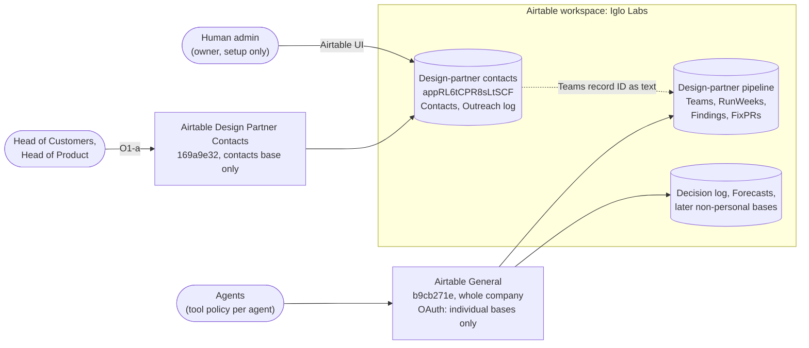

# ADR-008: Airtable access boundary for personal data

Status: accepted (Head of Tech, 2026-11-01)
Date: 2026-10-31, updated 2026-11-01 (board decision on O1, as-built connections, block policy on the contacts connection)
Owner: Architekt
Approver: Head of Tech
Issue: [IGL-55](/IGL/issues/IGL-55), from the [IGL-51 decision](/IGL/issues/IGL-51#document-decision)

## Context

The design-partner pipeline base (`appwLmvOxuSEuayfv`, built in IGL-36) will hold personal data: the Contacts and Outreach log tables. The [IGL-42 security review](/IGL/issues/IGL-42#document-security-review) found:

- **F1 (high):** every agent on the shared Airtable connection acts as workspace owner. Any agent can read, export, change or delete every table, Contacts included, and can create public share links. Airtable has no per-table read limit inside a base.
- **F2 (high):** the plan, the collaborators and the share links are not known, because the connection cannot show them.

Both must be fixed before the first Contacts record (IGL-42 section 5, condition 2 and 3). The Security Engineer re-checks before wave 1, 2026-11-23.

Constraints:

- **One shared connection.** The board ruled on IGL-30 (2026-10-31) that Airtable runs through one shared company connection in Paperclip, not one token per agent.
- **What the token can reach.** An Airtable OAuth token acts as the user who granted it, limited by scopes and by the bases or workspaces picked at authorization. The user can grant single bases, whole workspaces or everything, and can change the list later without revoking ([OAuth reference, "Token permissions"](https://airtable.com/developers/web/api/oauth-reference); [help: third-party integrations via OAuth](https://support.airtable.com/articles/6811769763-third-party-integrations-via-oauth-overview); both read 2026-10-31 by the Head of Tech). The granting user's workspace role is the ceiling, not the working level.
- **What Paperclip can limit.** Grants on a connection are per agent and per tool (Allowed / Ask first / Off). They decide *which tools* an agent may call, not *which base* a tool reaches.

So the base is the only hard boundary Airtable gives us, and the OAuth resource list is the only place we can enforce it for agents.

When this ADR was written (2026-10-31), the one shared connection reached every base at owner level, and all 20 agents held it with all 55 tools Allowed ([IGL-54](/IGL/issues/IGL-54), inventory).

The OAuth grants still carry the write scopes `schema.bases:write` and `data.records:write`. The base list limits *where* a connection reaches; the block policies (Decision steps 3 and 6) limit *what* agents can do there.

## Options

- **A: separate contacts base, excluded from the shared connection.** Move Contacts and Outreach log into a new base "Design-partner contacts". The pipeline base keeps Teams, RunWeeks, Findings and FixPRs. The link is the Teams record ID, stored as plain text. The shared connection is re-authorized with individual bases only, and the contacts base is never on that list.
- **B: one base, lower-role connection.** Keep all tables in one base. Agents that do not need Contacts use a second connection that belongs to an Airtable user with a lower role. Field and table edit permissions (paid plans) restrict writes, not reads.
- **Do nothing.** Keep one base and one owner-level connection that reaches every base. Rely on the rule in `tools-and-data.md` that each agent only touches its own tables.

## Evaluation

The template weights are changed for this ADR. It is an access decision, not a technology choice: security posture and the board ruling decide it, and performance is not a factor at our volume. Data integrity is added because option A breaks a linked-record field.

| Criterion | Weight | A: separate base | B: lower-role connection | Do nothing |
| --- | --- | --- | --- | --- |
| Security posture | 35% | 5 | 2 | 1 |
| Fit with the IGL-30 ruling | 20% | 4 | 1 | 5 |
| Agent fit | 15% | 4 | 4 | 5 |
| Cost of ownership | 15% | 3 | 3 | 5 |
| Data integrity | 10% | 3 | 5 | 5 |
| Lock-in risk | 5% | 3 | 3 | 3 |
| Weighted total | | **4.05** | 2.60 | 3.50 |

- Security posture: A puts Contacts out of the token's reach, so a prompt-injected agent cannot read it whatever tool it holds. B still lets every agent on the lower-role connection *read* Contacts, because Airtable cannot hide a table inside a base; the review calls B weaker than A. Do nothing leaves F1 open.
- Fit with IGL-30: A keeps one shared connection for all normal work. The only second connection is the narrow exception in O1, which the board chose. B is a second connection for the general case, which is what the board ruled against. Do nothing fits the ruling exactly.
- Agent fit: in A, agents work with a Teams record ID across two bases, a simple and common pattern. B is the same for agents. Do nothing needs no change.
- Cost of ownership: A adds a base, a re-authorization, and a manual step for every new base. B adds a second connection to run and maybe a paid seat. Do nothing costs nothing.
- Data integrity: in A the Team key is plain text, so Airtable does not stop a wrong or orphaned key. B and do nothing keep the linked-record field.
- Lock-in: the same for all three. Everything stays in Airtable.

The table informs the decision; it does not make it. Do nothing scores second only because it costs nothing, and it fails a hard condition: IGL-42 section 5 does not allow personal data in the base while F1 is open.

## Decision

**Option A.** The OAuth resource list enforces the boundary. Decided by the Head of Tech on [IGL-51](/IGL/issues/IGL-51#document-decision).

1. **Two bases.**
   - "Design-partner pipeline" (`appwLmvOxuSEuayfv`): Teams, RunWeeks, Findings, FixPRs. No names of people.
   - "Design-partner contacts" (new): Contacts, Outreach log.
   - The link is the Teams record ID, stored as plain text. No linked-record field crosses bases (Airtable cannot do that).
2. **The general connection does not reach the contacts base.** Its OAuth resource access is set to **individual bases only**: Design-partner pipeline, Decision log, Forecasts, and later non-personal bases, added one at a time. Not "all workspaces", not the workspace "Iglo Labs" as a whole, and never the contacts base. A new base is unreachable until a human adds it. That is the review step we want.
3. **No connection is used at owner level for normal work (F1).** The board kept one connection for general work, so the resource scope above plus a tool policy per agent replaces a lower-role account. Agent-Ops (owner of connections) sets the policy on **every** Airtable connection:
   - **Off for every agent:** `delete-table`, `delete-automation`, `delete-interface`, `delete-page`, `publish-form`, `publish-interface`, `create-automation`, `update-automation`, `test-automation-webhook-trigger`, `create-base`. Publishing can expose data to the public, and automations can send data out (webhook, email). These are setup actions for a human or a one-off grant.
   - **`delete-records-for-table`:** Ask first, and only for the record owner by role (the delete-by step in IGL-42 F3).
   - **Schema tools** (`create-table`, `create-field`, `update-field`, `update-table`): only for the agent that builds that base, removed when the build is done.
   - **Record tools:** only for agents named as writers or readers in `tools-and-data.md`.
   - **Owner role** stays with the human admin login and is used for setup only.
4. **Human collaborators** on the contacts base: only the people who need it. No shared view links, no published forms or interfaces, on either base.
5. **Admin check (F2).** A human with the Airtable admin login records in IGL-51: the plan, the collaborators per workspace and base, every share link, published form and published interface (expected: none), and the bases on the Paperclip OAuth grant.

6. **The contacts base has its own connection (O1-a, see below).** It reaches the contacts base only. Only Head of Customers (records read and write) and Head of Product (records read) may use it. **The control is block policy `6d7dbd39`:** every tool on the contacts connection is Off for every agent except those two. Installs and native gateway profiles are not a boundary in Paperclip: every agent gets a profile that lists all tools of a connection, and profiles cannot deny. Only block policies are checked on every call. The policy is a deny list, so every newly hired agent must be added to it at hire (step in `tools-and-data.md`).

Why the boundary is a base and not a tool rule: with one shared connection, any agent that holds a record-read tool can read every table on every base the token reaches. That includes agents that read untrusted partner pages and repos (IGL-41). Tools are not scoped per base, so no tool policy can fix this.

### O1: who reaches the contacts base (decided)

Option A left one question for the board, asked on [IGL-51](/IGL/issues/IGL-51). **The board picked O1-a, the exception connection, on 2026-11-01.** This is a narrow exception to the IGL-30 ruling: two Airtable connections in total, not one per agent.

What was weighed:

| | O1-a: exception connection (chosen) | O1-b: humans-only entry |
| --- | --- | --- |
| What | A second connection, limited to the contacts base only. Granted only to Head of Customers (write) and Head of Product (read). Two connections in total, not one per agent. | No agent touches Contacts. A human types contacts in the Airtable UI. Agents work with Teams record IDs only. |
| IGL-30 ruling | Narrow exception to the ruling. | Keeps the ruling in full. |
| Cost | One more connection to run and audit. | Human time for every contact and outreach entry; the Head of Customers cannot run outreach alone. |

### As built (2026-11-01)

The human did not re-authorize the old connection with fewer bases. They reused it for contacts and created a new one for general work:

| Connection | Paperclip ID | Bases it reaches | Installed for | Block policies |
| --- | --- | --- | --- | --- |
| Airtable General (new) | `b9cb271e-5823-449c-9d7c-1b4f07805277` | Design-partner pipeline (`appwLmvOxuSEuayfv`), Decision log, Forecasts | whole company | `b63a6dda`, `fd2ea28c`, `793b136f` |
| Airtable Design Partner Contacts (the old shared connection, renamed and limited) | `169a9e32-76e8-4e84-82e4-41edf380dcaf` | Design-partner contacts (`appRL6tCPR8sLtSCF`) only | Head of Customers, Head of Product (not a boundary, see step 6) | `b63a6dda`, `fd2ea28c`, `793b136f`, plus `6d7dbd39` (Off for every agent except Head of Customers and Head of Product) |

The Head of Tech verified the base scope of both connections with `list-bases` on 2026-11-01 ([IGL-51](/IGL/issues/IGL-51)). The tool policies did not follow the change, and the install list did not limit the contacts connection; see the first and third risks below. Policy state as of 2026-11-01 ([IGL-51](/IGL/issues/IGL-51) decision document, update 2; [IGL-54](/IGL/issues/IGL-54)).

## Evolution

Designed for the current stage: one human admin, one base with personal data, a handful of agents, wave 1 starting 2026-11-23.

Revisit (new ADR) when any of these happens:

- **A second base with personal data** is planned. Then the "add bases one at a time" list and the tool policy are no longer enough on their own, and a separate lower-role Airtable account becomes worth its seat.
- **More than one person** needs owner or creator access to the workspace, so owner is no longer "the human admin, setup only".
- **The board asks for a lower-role account**, or reverses or widens the IGL-30 ruling.

Also revisit if Airtable adds per-table read permissions inside a base, or if Paperclip grants can be scoped per base. Either one would make option B or a single base viable.

## Consequences

Easier:
- A prompt-injected or mistaken agent cannot read, export or delete Contacts, whatever tools it holds.
- New bases are unreachable by default. Adding a base to the grant is the review step.
- The IGL-42 section 5 condition 2 can be checked: list the bases on the grant.

Harder:
- Two bases to keep consistent. The Team key is plain text, so a deleted team can leave orphaned contacts. The weekly delete-by step (IGL-42 F3) must also clean contacts of deleted teams.
- Every new non-personal base needs a human to add it to the general connection.
- Two Airtable connections to run and audit, and every tool policy must exist on both.
- The contacts block policy is a deny list: every new agent must be added at hire, or it can use the contacts connection.
- Cross-base lookups take more API calls.

Given up:
- Linked-record fields, rollups and lookups between Teams and Contacts.
- One connection for everything (the IGL-30 ruling has one narrow exception now).

## Risks and mitigations

| Risk | Mitigation |
| --- | --- |
| **Tool policies are bound to a connection ID.** When a connection is replaced or a new one is added, the policies stay on the old ID and the new connection comes up with every tool Allowed for every agent. **This happened on 2026-11-01:** the new general connection had all 55 tools Allowed for every agent, including `delete-table`, `publish-form` and `create-base` ([IGL-54](/IGL/issues/IGL-54)). | Agent-Ops re-applies the tool policies after any Airtable connection change. The automated check in [IGL-63](/IGL/issues/IGL-63) asserts that every Airtable connection ID is covered by the Off-list policy. |
| Someone widens a connection's base list ("all workspaces"), and the contacts base is reachable through the general connection without anyone noticing. | Automated check [IGL-63](/IGL/issues/IGL-63) (Security Engineer), weekly in the Tuesday Security Check and after any Airtable connection change: `list-bases` on the general connection returns exactly the allowed list in `tools-and-data.md`, never the contacts base; `list-bases` on the contacts connection returns only `appRL6tCPR8sLtSCF`. |
| More agents than Head of Customers and Head of Product can use the contacts connection. **This happened on 2026-11-01** (first run of [IGL-63](/IGL/issues/IGL-63)): every agent had a native gateway profile listing all 55 tools of `169a9e32`, and the install list did not restrict calls. Cause: profiles list every tool of a connection and cannot deny; only block policies are checked on every call. | Block policy `6d7dbd39` (Off for every agent except Head of Customers and Head of Product), set by Agent-Ops ([IGL-54](/IGL/issues/IGL-54)). New-hire step in `tools-and-data.md`: add the agent to the policy at hire. IGL-63 assertion 3b proves it with a denied call from an agent outside the two. |
| Tool policy drifts: a new agent gets a connection with every tool Allowed. | Agent-Ops records which agents hold each connection and their tool grants in `tools-and-data.md`; the IGL-63 check covers the Off-list on every connection. |
| Orphaned contacts after a team is deleted. | The weekly delete-by step also deletes contacts whose Team key no longer exists. |
| Personal data leaks into the pipeline base through free text (a name in `Independence note`, `Source`, `Reply`). | IGL-42 rules F4 and condition 7 (no names of people in Teams, RunWeeks, Findings, FixPRs). |

## Cost impact

No new Airtable seat: the decision avoids a second Airtable account. The new base sits in the existing workspace; that the plan's base limit allows it is not verified here and is part of the F2 admin check. Cost drivers: API calls (cross-base lookups count against the plan limit), and the second (contacts) connection to run and audit.

## Security review

Required: the decision touches customer personal data and the access of an external service. Input review: [IGL-42 security review](/IGL/issues/IGL-42#document-security-review) (F1, F2, sections 1 and 5). The Security Engineer re-checks the implemented state before wave 1 (2026-11-23), as planned in IGL-42 section 5.

## Diagrams

- `docs/architecture/context.md` is not changed. It does not list Airtable: it shows the Fram CI runtime only (added in the ADR-004 PR, not yet on `main`).
- The diagram of the two bases and the connections is in this ADR, under Decision.
