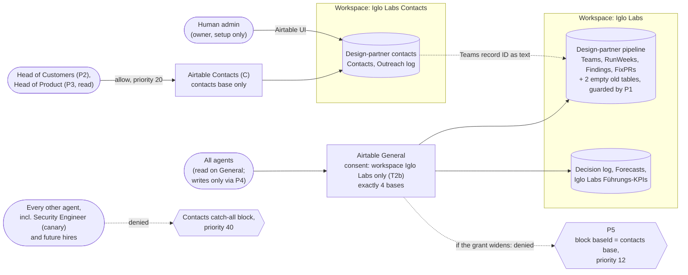

# ADR-008: Airtable access boundary for personal data

Status: accepted, takes effect at the wave 1 trigger. Until then, D-2026-11-01-01 applies.
Date: 2026-10-31, updated 2026-11-01 (board decision on O1; CEO deferral D-2026-11-01-01; boundary design for the trigger from IGL-71, revision 4)
Owner: Architekt
Approver: Head of Tech
Issues: [IGL-55](/IGL/issues/IGL-55) (first version), [IGL-74](/IGL/issues/IGL-74) (this revision). Source of the decision: [IGL-71 design document](/IGL/issues/IGL-71#document-design), **revision 4** (2026-11-01, 12:37 UTC), which revises the [IGL-51 decision](/IGL/issues/IGL-51#document-decision), decisions 1 to 3 and update 4.

## Where the live identifiers are

This repository is public. This ADR records the decision and the rules. It does not record live identifiers: Airtable base, table and workspace IDs, Paperclip connection, agent and policy IDs, or the current state of each trigger step. Those are on [IGL-71](/IGL/issues/IGL-71#document-design), which is internal:

- connection, base, table and workspace IDs: design sections 0 to 2;
- agent IDs: design sections 3 and 4;
- policy IDs, mapped to the policy names used below: design section 4;
- verified current state and trigger progress: design sections 0 and 7a.

Names used in this ADR: **General** (the shared Airtable connection), **`C`** (the contacts connection), **pipeline base**, **contacts base** (`appK` in the design), **"Iglo Labs"** and **"Iglo Labs Contacts"** (the two Airtable workspaces).

Keep live identifiers out of this file and out of the PR. Add them on IGL-71.

## Current state: D-2026-11-01-01 applies until the trigger

**CEO decision D-2026-11-01-01** (2026-11-01, on [IGL-62](/IGL/issues/IGL-62) and [IGL-51](/IGL/issues/IGL-51)): every agent has full access to every Airtable base until real customer data is in Airtable. Nothing in the Decision section below is in force before the trigger. Until then, the five existing Airtable policies stay disabled (not deleted), the [IGL-63](/IGL/issues/IGL-63) boundary check is paused, and the two old tables `Contacts` and `Outreach log` in the pipeline base stay empty. No personal data goes into Airtable before the trigger.

The verified state and the progress of each trigger step are tracked on [IGL-71](/IGL/issues/IGL-71#document-design) (sections 0 and 7a), not here.

**Trigger:** the Decision below is applied before the first record is written to `Contacts` or `Outreach log`. Wave 1 is planned for 2026-11-23. Head of Customers flags the trigger on [IGL-71](/IGL/issues/IGL-71) by 2026-11-16. The steps are in [Trigger sequence](#trigger-sequence).

## Context

The design-partner pipeline (the pipeline base, built in IGL-36) will need personal data: contacts and an outreach log. The [IGL-42 security review](/IGL/issues/IGL-42#document-security-review) found:

- **F1 (high):** every agent on the shared Airtable connection acts as workspace owner. Any agent can read, export, change or delete every table, contacts included, and can create public share links. Airtable has no per-table read limit inside a base.
- **F2 (high):** the plan, the collaborators and the share links are not known, because the connection cannot show them.

Both must be fixed before the first contact record (IGL-42 section 5, conditions 2 and 3).

Constraints:

- **One shared connection for general work.** The board ruled on IGL-30 (2026-10-31) that Airtable runs through one shared company connection in Paperclip, not one token per agent. The board later allowed one narrow exception for contacts (O1-a, below).
- **What the token can reach.** An Airtable OAuth token acts as the user who granted it, limited by scopes and by the bases or workspaces picked at authorization. The user can grant single bases, whole workspaces or everything, and can change the list later without revoking ([OAuth reference, "Token permissions"](https://airtable.com/developers/web/api/oauth-reference); [help: third-party integrations via OAuth](https://support.airtable.com/articles/6811769763-third-party-integrations-via-oauth-overview); both read 2026-10-31 by the Head of Tech). The granting user's workspace role is the ceiling.
- **The OAuth grants carry write scopes** `schema.bases:write` and `data.records:write` (accepted in IGL-51 update 2). The base list limits *where* a connection reaches. The policies limit *what* agents can do there.

### How the Paperclip policy engine decides

Read in source by the Head of Tech: `server/src/services/tool-access-policy.ts`, `decide()`, upstream commit `b43073d11`.

1. Enabled policies are evaluated in ascending `priority`, then `createdAt`. **The first matching policy returns.** `block` denies, `require_approval` asks, `allow` allows before gateway profiles are consulted.
2. **Actor conditions can only list agents** (`agentId(s)`, `actorType(s)`). There is no "everyone except" form. A block policy with an agent list is a deny list, and every new hire slips past it.
3. **Policies can match tool arguments** (`conditions.arguments.fieldIn`, `fieldEquals`, `fieldMatches`). This corrects IGL-51 update 4, which said a block policy cannot match a base or table. That is true of the 5 existing policies, not of the engine.
4. **Installs and native gateway profiles are not a boundary.** Every agent gets a profile that lists all tools of a connection, and profiles cannot deny. This was found on 2026-11-01 in the first IGL-63 run.

The source tree may differ from the deployed server. Assertions A3 to A6 prove the behaviour live.

## Options

### Where contacts live

- **A: separate contacts base that the general connection cannot reach.** Contacts and Outreach log move to a new base. The pipeline base keeps Teams, RunWeeks, Findings and FixPRs. The link is the Teams record ID as plain text.
- **B: one base, lower-role connection.** All tables in one base. Agents that do not need contacts use a second connection that belongs to an Airtable user with a lower role. Field and table edit permissions (paid plans) restrict writes, not reads.
- **Do nothing.** One base, one owner-level connection. Rely on the rule in `tools-and-data.md` that each agent only touches its own tables.

### How the contacts path is enforced

- **E1: deny list** (the first, deferred design). The block policy on the contacts connection lists every agent except Head of Customers and Head of Product. Each new hire must be added.
- **E2: allow-list, then a catch-all block** (this revision). Allow policies name the two agents. A block policy with no actor condition comes after them and catches everyone else.
- **E3: argument match as the boundary.** Block calls whose arguments name the contacts base or tables, on a single connection.

## Evaluation

The template weights are changed for this ADR. It is an access decision, not a technology choice: security posture and the board ruling decide it, and performance is not a factor at our volume. Data integrity is added because option A breaks a linked-record field.

| Criterion | Weight | A: separate base | B: lower-role connection | Do nothing |
| --- | --- | --- | --- | --- |
| Security posture | 35% | 5 | 2 | 1 |
| Fit with the IGL-30 ruling | 20% | 4 | 1 | 5 |
| Agent fit | 15% | 4 | 4 | 5 |
| Cost of ownership | 15% | 3 | 3 | 5 |
| Data integrity | 10% | 3 | 5 | 5 |
| Lock-in risk | 5% | 3 | 3 | 3 |
| Weighted total | | **4.05** | 2.60 | 3.50 |

- Security posture: A puts contacts out of the general token's reach, so a prompt-injected agent cannot read them whatever tool it holds. B still lets every agent on the lower-role connection *read* contacts, because Airtable cannot hide a table inside a base. Do nothing leaves F1 open.
- Fit with IGL-30: A keeps one shared connection for all normal work, plus the narrow exception the board chose (O1-a). B is a second connection for the general case, which the board ruled against.
- Agent fit: in A, agents work with a Teams record ID across two bases, a simple and common pattern.
- Cost of ownership: A adds a base, a workspace, a second connection and a manual step for every new base. B adds a second connection and maybe a paid seat.
- Data integrity: in A the Team key is plain text, so Airtable does not stop a wrong or orphaned key.

Do nothing scores second only because it costs nothing, and it fails a hard condition: IGL-42 section 5 does not allow personal data in a reachable base while F1 is open.

Enforcement, compared on the one property that decides it, which is what happens to an agent nobody thought of:

| | E1: deny list | E2: allow-list + catch-all block | E3: argument match |
| --- | --- | --- | --- |
| New hire | **gets full access** until someone adds them | denied by default | depends on the argument the agent passes |
| Happened already | yes: Reviewer Terra (now Reviewer Sol) and Reviewer Opus were hired after the policies and are in neither deny list | no | not used |
| Weakness | needs a step at every hire, and the step was missed | none found for this case | read tools accept table *names* (`list_records_for_table.tableId` takes a name or an ID), so a match on IDs can be bypassed |

E1 would have given both reviewers full access to contacts if the old policies had been re-enabled as they are. E2 removes that failure mode instead of patching the list. E3 is a guard, not a boundary; this ADR uses it for two narrow cases where the tool schema forces IDs (policies P1 and P5).

## Decision

**Option A with enforcement E2.** Decided by the Head of Tech on [IGL-71](/IGL/issues/IGL-71#document-design). Applies from the trigger.

### 1. Bases and workspaces

- **"Design-partner pipeline"** (the pipeline base) keeps Teams, RunWeeks, Findings, FixPRs. No names of people.
- **"Design-partner contacts"** (the contacts base, new, created by the human at T2) holds `Contacts` and `Outreach log`, with the same fields as the two empty tables in the pipeline base. The link to a team is the Teams record ID as plain text. No linked-record field crosses bases. Airtable's default first table may be reused under P0 or left empty. Its AI field `Attachment Summary` is not used for contacts.
- **The contacts base lives in a separate Airtable workspace, "Iglo Labs Contacts".** Why: it is not known whether General's OAuth grant names individual bases or the whole workspace. One base became reachable by General without being on the IGL-51 update 1 list, so either a human added it or the grant covers the workspace. If it covers the workspace, a contacts base created there would be reachable by General with no consent step.
- **The separate workspace is not a boundary by itself.** The first draft of this revision said a separate workspace "makes that impossible either way". That was wrong: General's grant reached the new workspace and base as soon as they were created (IGL-71, revision 3). It is still open whether General's grant covers every current and future workspace or whether General was re-consented. **The boundary is General's consent, limited to the "Iglo Labs" workspace** (or to the 4 bases in section 2), set by the human at step T2b and checked by A1. The separate workspace still helps, because General can be re-consented to "Iglo Labs" only, without listing each base.
  - **Second layer: guard P5** (section 4) blocks every General call whose `baseId` argument is the contacts base. If General's grant widens again, P5 denies those calls at the policy layer, and A1 catches the wider grant at the next run.
  - **Cost:** verified at T2, a second workspace costs nothing on our plan.
  - **Fallback (not used):** same workspace, but only after the human confirms on the consent screen that General is granted per base. A1 catches it if that is wrong.
- **The human creates the base**, empty, in the Airtable UI, in the same browser session as the OAuth consent. Agents do not create it: `create_base` is on the Off-list, and a base created through General could end up inside General's grant.
- **Head of Customers builds the tables** through `C`, under the temporary schema allow P0. Agent-Ops deletes P0 after the build and before the first record.

### 2. Connections and the bases they reach

| Connection | Allowed bases (exact set) | Never |
| --- | --- | --- |
| Airtable General, unchanged | exactly 4, all in workspace "Iglo Labs": Decision log, Forecasts, Iglo Labs Führungs-KPIs, Design-partner pipeline | the contacts base and the "Iglo Labs Contacts" workspace |
| Airtable Contacts, **`C`**: the archived contacts connection if it comes back active after the human re-consents it, otherwise a new connection | the contacts base only, in "Iglo Labs Contacts" | every other base |

The IDs of both connections, the 4 bases, the contacts base and both workspaces are on IGL-71 (design sections 1 and 2).

- Agent-Ops records the final value of `C` (and confirms the contacts base ID) on IGL-71 at step T3, before any policy is changed. From then on, `C` means that ID. Policies are bound to connection IDs (IGL-51 update 1), so Agent-Ops rebinds them in both outcomes.
- **A base that shows up in General and is not on this list is a failure.** It passes only after the Head of Tech adds it to this table. That is how new bases get reviewed.
- **There are exactly 2 active Airtable connections**, General and `C`. A third active Airtable connection is a failure (A9) until the Head of Tech adds it to this table.

### 3. Agents on the contacts path

| Agent | On `C` |
| --- | --- |
| Head of Customers | the 14 read tools, plus `create_records_for_table`, `update_records_for_table`, `create_record_comment`. `delete_records_for_table`: ask first. Nothing else. |
| Head of Product | the 14 read tools only |
| Security Engineer | `C` installed, **every call denied** by the contacts catch-all block (rev 4, below) |
| Every other agent, **including every future hire** | all tools denied |

Board answer of 2026-11-01 (O1-a, below). The Security Engineer gets no access (IGL-51 update 2). Their own denied call is the proof (A3).

**`C` stays installed for the Security Engineer, permanently** (IGL-71 revision 4, Head of Tech's answer on A3). They see the `C` tools, but every call is denied by the contacts catch-all block at 40, because no allow policy names them. Without the install, their `list_bases` call on `C` never reaches the policy engine, and A3 would only prove the install restriction, which is not the boundary. With it, A3 is a live canary on every weekly run: a Paperclip update that changes policy semantics shows up as a failed A3, not as silent exposure.

**Accepted risk:** if the contacts catch-all block ever fails open, the Security Engineer is the one agent that gains read access to contacts, and they are also the agent who reports it.

The 14 read tools: `analyze_table`, `get_record_for_page`, `get_table_schema`, `list_bases`, `list_record_comments`, `list_records_for_page`, `list_records_for_table`, `list_tables_for_base`, `list_views_for_table`, `list_workspaces`, `ping`, `search_bases`, `search_candidate_linked_records`, `search_records`. These are the 55 Airtable tools minus the 36 on the Off-list and the 5 record write tools in the General write block.

The install list and gateway profiles on `C` are restricted to the pair **plus the Security Engineer**. **They are not the boundary.** The policies in section 4 are.

### 4. Policies

On `C`, access is an **allow-list followed by a catch-all block with no actor condition.** Because the first match wins, an agent that no allow policy names falls through to the block. New hires are denied by default. The same pattern applies to record writes on General.

Five existing policies are reused, named here by role. Their IDs, and the agent IDs, are on IGL-71 (design section 4).

| Priority | Policy | Type | Connection | Tools | Actor | Change at trigger |
| --- | --- | --- | --- | --- | --- | --- |
| 5 | **P0**, new, temporary | allow | `C` | `create_table`, `create_field`, `update_field`, `update_table` | Head of Customers | create at T4, **delete before the first record** |
| 10 | Off-list block (existing) | block | General + `C` | the 36 Off tools, unchanged | none (everyone) | bind to `C` if `C` is new; priority 10; enable |
| 12 | **P5**, new (rev 3): guard on the contacts base | block | General | all (no tool selector) | none | condition `arguments.fieldEquals.baseId` = the contacts base ID; create at T3 |
| 15 | **P1**, new: guard on the old tables | block | General | `create_records_for_table`, `update_records_for_table` | none | condition `arguments.fieldIn.tableId` = the IDs of the 2 old tables |
| 20 | **P2**, new | allow | `C` | 14 read + 3 write tools (section 3) | Head of Customers | create |
| 20 | **P3**, new | allow | `C` | 14 read tools | Head of Product | create |
| 20 | **P4**, new | allow | General | `create_records_for_table`, `update_records_for_table`, `create_record_comment`, `revert_action` | Chief of Staff, Prognostiker, Head of Customers, Head of Marketing | create (same 4 writers as today) |
| 30 | General delete ask-first (existing) | require_approval | General | `delete_records_for_table` | the same 4 writers | priority 30; enable |
| 30 | Contacts delete ask-first (existing) | require_approval | `C` | `delete_records_for_table` | Head of Customers | rebind → `C`; priority 30; enable |
| 40 | Contacts catch-all block (existing) | block | `C` | **all** (no tool selector) | **none** (delete the agent list) | rebind → `C`; delete the actor condition; priority 40; enable |
| 40 | General write block (existing) | block | General only | the 5 record write tools | **none** (delete the agent list) | remove the old contacts connection; delete the actor condition; priority 40; enable |

Why the order holds:

- The Off-list (10) comes before every allow, so no allow can unlock a delete, publish or automation tool. P0 (5) is the only thing above it, and only for the 4 schema tools, only for Head of Customers, only on `C`, and only during T4. No other policy that matches General or `C` may sit below priority 10 (A8).
- The contacts-base guard P5 (12) comes before the General allow P4 (20), so no writer can reach the contacts base through General, even if General's grant widens again. Tools that take `baseId` require an `app…` ID (schema `pattern: ^app[A-Za-z0-9]{14}$`), so a base name cannot get round it. The listing tools take no `baseId`, so P5 cannot hide the base from a listing if the grant widens. That is why A1, not P5, is the boundary check.
- The table guard P1 (15) comes before the writers' allow P4 (20), so no one can write into the two old pipeline tables. Both write tools *require* a `tbl…` ID (schema `pattern: ^tbl[A-Za-z0-9]{14}$`), so a table name cannot get round the guard.
- P1 and P5 depend on those two schema patterns. A8 re-reads the tool schemas on every run and fails if either pattern changes.
- The ask-first policies for `delete_records_for_table` (30) come after the allows. The allows don't include delete, so a writer's delete falls through to ask-first, and anyone else's delete hits the block at 40.
- Head of Product's write attempt on `C` matches nothing until 40, so it is denied. So is `revert_action` by Head of Customers on `C`, and every call by the Security Engineer on `C`.
- Read tools on General match no policy and stay open to every agent. General reaches no personal data.
- **No other enabled `allow` may match General or `C`**, including an allow with no connection selector. One stray allow above 10 would bypass the Off-list and the whole contacts path. A8 checks it.

**Argument matching is a guard, not the base boundary.** The engine can match tool arguments (Context, point 3), and P1 and P5 use it. It is not the boundary that keeps contacts apart, because argument names differ per tool, read tools accept table names as well as IDs, and the listing tools take no base argument at all. Airtable enforces the base boundary: after T2b, General's consent does not reach the contacts workspace (A1).

Result: 5 existing policies reused, 5 new permanent ones (P1 to P5), 1 temporary (P0). That makes 10 permanent policies. Agent-Ops updates `tools-and-data.md`: the step "add new hire to the contacts block" is removed, and the rule becomes "new agents get no Airtable writes and no contacts access unless the Head of Tech adds them to P2, P3 or P4".

### 5. The two empty tables in the pipeline base

They stay in place and empty. Nothing is deleted, so no CEO approval is needed. P1 makes any write into them fail for every agent, so a contact can't land in the old place by mistake. A7 checks that both still have 0 records. Deleting them later needs CEO approval and a human in the Airtable UI. `delete_table` stays on the Off-list with no exception (IGL-51 update 2).

### 6. Human collaborators and admin facts (F2)

- On the contacts base: only the people who need it. No shared view links, no published forms or interfaces, on any base.
- **Owner role** stays with the human admin login and is used for setup only.
- A human with the Airtable admin login records on IGL-71 at step T2: the collaborators per workspace and base, every share link, published form and published interface (expected: none). A10 reads this.

### O1: who reaches the contacts base (decided)

**The board picked O1-a on 2026-11-01:** a second connection, limited to the contacts base, for Head of Customers and Head of Product only. This is a narrow exception to the IGL-30 ruling: two Airtable connections in total, not one per agent.

| | O1-a: exception connection (chosen) | O1-b: humans-only entry |
| --- | --- | --- |
| What | A second connection, limited to the contacts base. Head of Customers (write) and Head of Product (read). | No agent touches contacts. A human types them in the Airtable UI. Agents work with Teams record IDs only. |
| IGL-30 ruling | Narrow exception. | Keeps the ruling in full. |
| Cost | One more connection to run and audit. | Human time for every contact and outreach entry; Head of Customers cannot run outreach alone. |

### Diagram (state after the trigger)

## Definition: "boundary holds"

The boundary holds when all of A1 to A10, including A6b, pass. The [IGL-63](/IGL/issues/IGL-63) check runs them ([IGL-70](/IGL/issues/IGL-70)) after T4 and before T6, then weekly and after every Airtable connection change. Every probe that could write uses `update_records_for_table` with a record ID that does not exist (for example `recAAAAAAAAAAAAAA`). If a policy wrongly allows the call, Airtable rejects it and no data changes.

The exact IDs each probe uses are in the IGL-63 procedure and on IGL-71. This table states what has to be true.

| # | Assertion | How | Pass |
| --- | --- | --- | --- |
| A1 | General reaches exactly the 4 bases in Decision section 2, and not the contacts workspace | `list_bases` and `list_workspaces` on General | base set equals; the only workspace is "Iglo Labs" |
| A2 | `C` reaches exactly the contacts base | `list_bases` on `C`, run by Head of Product at the Security Engineer's request (IGL-51 update 2) | set equals the contacts base |
| A3 | Agents outside the pair are denied on `C` | Security Engineer calls `list_bases` on `C` (`C` is installed for them, Decision section 3) | `deny_policy_block`, by the contacts catch-all block. If the `C` tools are not visible to the Security Engineer, A3 **fails** (install drift). It does not pass on A8 |
| A4 | Off-list holds | Security Engineer calls `list_automations` on General | denied by the Off-list block |
| A5 | Non-writers can't write on General | Security Engineer calls `update_records_for_table` (nonexistent record) on a pipeline table **other than** the 2 old tables | denied by the General write block. An Airtable "record not found" error is a **fail**: the policy let the call through |
| A6 | Old tables are guarded | the same probe, targeting the old `Contacts` table | denied by **P1**. A deny from the General write block alone is a **fail**, because that block does not stop the 4 writers |
| A6b | Contacts base is guarded on General | Security Engineer calls `list_tables_for_base` with the contacts base ID on General | denied by P5 (after T2b, Airtable may deny first; either denial passes) |
| A7 | Old tables are empty | `list_records_for_table` on both | `totalRecordCount` 0 |
| A8 | Policy structure matches Decision section 4 | `GET /companies/{id}/tools/policies`, plus the Airtable tool schemas | the 10 policies enabled with the listed priorities and selectors; P2, P3, P4 name only the listed agents; P3 has only read tools; the contacts catch-all block and the General write block have no actor condition; P0 absent. **Also:** no other enabled `allow` matches General or `C`, including policies with no connection selector; no enabled policy that matches General or `C` sits below priority 10; the tool schemas still require `^tbl[A-Za-z0-9]{14}$` for `tableId` in `create_records_for_table` and `update_records_for_table` (P1 depends on it) and `^app[A-Za-z0-9]{14}$` for `baseId` (P5 depends on it) |
| A9 | Airtable connections match Decision section 2 | the same call plus `GET /tools/connections` | every `connectionIds` entry of an enabled Airtable policy is an active Airtable connection; **exactly 2** active Airtable connections (General and `C`), and the Off-list block covers both. A third active Airtable connection is a **fail** until it is added to Decision section 2 |
| A10 | Admin facts (F2) recorded by the human | read IGL-71 | collaborators listed; no share links, published forms or interfaces |

A8 and A9 replace "test as every agent" with a structure check, which also catches drift such as the missing reviewers.

If any assertion fails, no record is written. The owner of the failing step fixes it, and T5 runs again.

## Trigger sequence

Progress on each step is recorded on [IGL-71](/IGL/issues/IGL-71#document-design) (section 7a).

| Step | Owner | Action |
| --- | --- | --- |
| T0 | Head of Customers | Flags the trigger on IGL-71, **by 2026-11-16 at the latest** for wave 1 on 2026-11-23. Later than that is still before the first record. |
| T1 | Head of Tech | One board card: the human steps in T2 plus the admin facts (F2). |
| T2 | Human (about 5 min) | Creates the workspace "Iglo Labs Contacts" (or confirms the fallback, Decision section 1) and the empty base. Gives OAuth consent for `C` to that base only. Records the admin facts. |
| T2b | Human, Head of Tech | (rev 3) The human re-consents General to "Iglo Labs" only and names `C`. The Head of Tech re-runs `list_workspaces` and `list_bases` on General and unblocks T3 only when the contacts workspace and base are gone. |
| T3 | Agent-Ops | Records `C` and confirms the contacts base ID on IGL-71. Applies Decision section 4 except P0 (P5 included). Restricts the install of `C` to the pair **plus the Security Engineer** (rev 4, for A3). |
| T4 | Head of Customers, Agent-Ops | Agent-Ops creates P0. Head of Customers builds the 2 tables. Agent-Ops deletes P0. |
| T5 | Security Engineer | Runs A1 to A10 (with A6b) and posts the result (IGL-70). |
| T6 | Head of Customers | Writes the first contact record **only after T5 passes** and the Head of Tech confirms on IGL-71. |

Nobody writes to the contacts base until T5 passes.

## What this revision changes from the first version

The first version of this ADR (IGL-55, commits up to `220fdca`) was built on the morning of 2026-11-01 and then deferred. This revision keeps option A and O1-a and changes:

| First version | This revision | Why |
| --- | --- | --- |
| Contacts base in the "Iglo Labs" workspace | Separate workspace "Iglo Labs Contacts" (fallback: same workspace after per-base consent is confirmed) | It is not known whether General's grant covers the whole workspace |
| (not in the first version) | The boundary is General's consent limited to "Iglo Labs" (step T2b), checked by A1 with `list_workspaces`. The separate workspace alone is not a boundary | Rev 3: General's grant reached the new workspace and base as soon as they were created |
| (not in the first version) | Guard P5 at 12 blocks General calls on the contacts base; assertion A6b | Rev 3: a second layer if General's grant widens again |
| The contacts block is a deny list of every agent except the pair; add each new hire | Allow policies P2, P3 at 20, then the contacts catch-all block at 40 with no actor condition; no new-hire step | The engine is first match, and actor conditions can't say "everyone except". The deny list already missed Reviewer Terra and Reviewer Opus |
| The write block with an agent list, on both connections | Allow P4 for the 4 writers at 20, then the General write block at 40 with no actor condition, General only | Same reason |
| "A block policy cannot match a base or table" (IGL-51 update 4) | The engine can match arguments; used only as the guards P1 and P5 | Read in source; read tools take table names, so it is not a boundary |
| Old `Contacts` and `Outreach log` to be moved | Stay in the pipeline base, empty, write-guarded by P1 | Nothing is deleted, so no CEO card |
| IGL-63 with 3 assertions | A1 to A10, plus A6b | Structure checks (A8, A9) catch drift that per-agent tests miss |
| Install of the contacts connection limited to the pair | `C` also installed for the Security Engineer, all calls denied (live canary for A3) | Rev 4: without the install, A3 tests the install, not the policy |
| (not in the first version) | Stricter pass conditions: A3 fails on install drift; A5 targets a non-guarded table and fails on "record not found"; A6 must be denied by P1; A8 checks for stray allows, priorities below 10 and the schema patterns; A9 requires exactly 2 active Airtable connections | Rev 4: the Security Engineer's IGL-63 procedure, accepted by the Head of Tech |
| Live IDs in the ADR | Names only; IDs on IGL-71 | The repository is public (Security Engineer review of this PR) |

### As built on 2026-11-01 morning (no longer exists)

Kept as the record of how the first version was built. Replaced at about 12:00 UTC by the open state under Current state.

| Connection | Bases it reached | Installed for | Block policies |
| --- | --- | --- | --- |
| Airtable General (new) | Design-partner pipeline, Decision log, Forecasts | whole company | Off-list block, write block, delete ask-first |
| Airtable Design Partner Contacts (old shared connection, renamed and limited) | the first contacts base only (since deleted by the CEO, [IGL-62](/IGL/issues/IGL-62)) | Head of Customers, Head of Product (not a boundary) | the same three, plus the contacts block as a deny list |

## Evolution

Designed for the current stage: one human admin, one base with personal data, about 20 agents, wave 1 starting 2026-11-23.

Revisit (new ADR that supersedes this one) when any of these happens:

- **A second base with personal data** is planned. Then the per-connection base list and the policies may not be enough on their own, and a lower-role Airtable account becomes worth its seat.
- **More than one person** needs owner or creator access to a workspace.
- **The board asks for a lower-role account**, or reverses or widens the IGL-30 ruling.
- **The second workspace starts to cost money** (verified free at T2 on 2026-11-01) and the CEO declines it, so the same-workspace fallback becomes the design.
- **General's grant widens again** after T2b: A1 shows the contacts workspace or base, or P5 shows up as the deciding policy in a denied call. Then per-consent scoping is not stable enough, and a separate Airtable account for contacts becomes worth its cost.
- **The policy engine changes** its evaluation order or gains an "everyone except" actor condition. A3 to A6 or A8 failing on an unchanged policy set is the signal.
- **The Airtable tool schemas drop the `tbl…` or `app…` ID patterns** (A8 fails on the pattern check). Then P1 or P5 can be bypassed by a name, and the guards need a new design.
- Airtable adds per-table read permissions inside a base, or Paperclip scopes grants per base. Either would make option B or a single base viable.

## Consequences

Easier:

- A prompt-injected or mistaken agent outside the pair cannot reach contacts, whatever tools it holds: after T2b General can't see the base, P5 denies it there if the grant widens, and `C` denies it.
- **New hires are denied by default** on `C` and for record writes on General. The hiring step "add to the contacts block" is gone.
- New bases are unreachable by default. Adding a base to the list in Decision section 2 is the review step.
- "Boundary holds" is a fixed list (A1 to A10) that can be run, not a judgement call. A3 runs as a live canary every week.

Harder:

- Two bases in two workspaces to keep consistent. The Team key is plain text, so a deleted team can leave orphaned contacts. The weekly delete-by step (IGL-42 F3) must also clean contacts of deleted teams.
- Every new non-personal base needs a human to add it to General and the Head of Tech to add it to the allowed list.
- Two connections to run and audit. Every policy change must keep the priorities in Decision section 4, because order is the logic.
- Giving a new agent writes or contacts access is now an explicit change to P2, P3 or P4 by the Head of Tech.
- Cross-base lookups take more API calls.
- Live IDs live on IGL-71, not here, so reading the full picture needs Paperclip access.

Given up:

- Linked-record fields, rollups and lookups between Teams and contacts.
- One connection for everything (the IGL-30 ruling has one narrow exception).

## Risks and mitigations

| Risk | Mitigation |
| --- | --- |
| **Policies are bound to a connection ID.** When a connection is replaced, they stay on the old ID and the new connection comes up with every tool allowed. This happened on 2026-11-01 ([IGL-54](/IGL/issues/IGL-54)). | Agent-Ops records `C` at T3 before changing any policy, then rebinds. A9 fails if any enabled policy points at a dead connection, or if a third Airtable connection is active. |
| A new agent is hired and nobody updates a list. This happened with the deny lists: Reviewer Terra and Reviewer Opus. | Allow-list plus catch-all block (Decision section 4). A3 and A5 prove it with a denied call from an agent outside the lists; A8 checks that the blocks have no actor condition. |
| Someone widens a connection's base list, or the grant covers every workspace. **This has happened once:** General's grant reached the new contacts workspace when it was created (IGL-71, revision 3). | The human re-consents General to "Iglo Labs" only (T2b). P5 blocks General calls on the contacts base as a second layer. A1 compares the base set and the workspace list exactly, and A2 compares the base set on `C`, weekly and after every connection change. |
| Why General's grant reached the new workspace (a grant covering every workspace, or a re-consent) is still open. | Asked in the T2b card. Whatever the answer, A1 after T2b decides whether the boundary holds. |
| Policy order is changed by mistake (for example an allow moved above the Off-list), or a stray allow is added. | A8 checks every priority and selector against Decision section 4, fails on any other enabled allow that matches General or `C` (also with no connection selector), and fails on any matching policy below priority 10. |
| P0 stays after the table build and leaves schema tools open on `C`. | P0 is deleted before the first record (T4). A8 fails if P0 exists. T6 waits for T5. |
| The deployed server behaves differently from the source read on `b43073d11`. | A3 to A6 test the behaviour live, not the source. A3 runs every week as a canary through the Security Engineer's install. |
| The contacts catch-all block fails open. | Accepted (Decision section 3): the Security Engineer is the one agent outside the pair with `C` installed, and A3 is their own call, so they see it first and report it. |
| Argument match in P1 or P5 is bypassed. | The two write tools require a `tbl…` ID by schema, and tools that take `baseId` require an `app…` ID, so a name is rejected. A8 re-reads the schemas on every run and fails if either pattern changes. P1 and P5 are guards only: the old tables also stay empty (A7), and the base boundary is General's consent (A1). |
| A contact is written into the old tables in the pipeline base. | P1 blocks writes for every agent. A7 checks both stay at 0 records. |
| Personal data leaks into the pipeline base through free text (a name in `Independence note`, `Source`, `Reply`). | IGL-42 rule F4 and condition 7: no names of people in Teams, RunWeeks, Findings, FixPRs. |
| Orphaned contacts after a team is deleted. | The weekly delete-by step also deletes contacts whose Team key no longer exists. |
| The public repository gives an attacker a targeting map (base, connection, agent and policy IDs, open gaps) for prompt injection through page content. | This ADR names roles and policies but no live IDs or current state; those are on IGL-71. Earlier commits on the PR branch contain IDs. They are identifiers, not secrets, so the Security Engineer requires no history rewrite or rotation. |

## Cost impact

No new Airtable seat. The second workspace costs nothing on our plan (verified by the human at T2 on 2026-11-01). Other cost drivers: API calls (cross-base lookups count against the plan limit) and a second connection to run and audit.

## Security review

Required: the decision touches customer personal data and the access of an external service. Input: [IGL-42 security review](/IGL/issues/IGL-42#document-security-review) (F1, F2, sections 1 and 5). The Security Engineer reviews this revision on [IGL-74](/IGL/issues/IGL-74), not on the public PR, and runs A1 to A10 and A6b at T5 ([IGL-70](/IGL/issues/IGL-70)) before the first contact record.

## Diagrams

- `docs/architecture/context.md` is not changed. It shows the Fram CI runtime only and does not list Airtable.
- The diagram of the workspaces, bases, connections and the catch-all block is in this ADR, under Decision.
