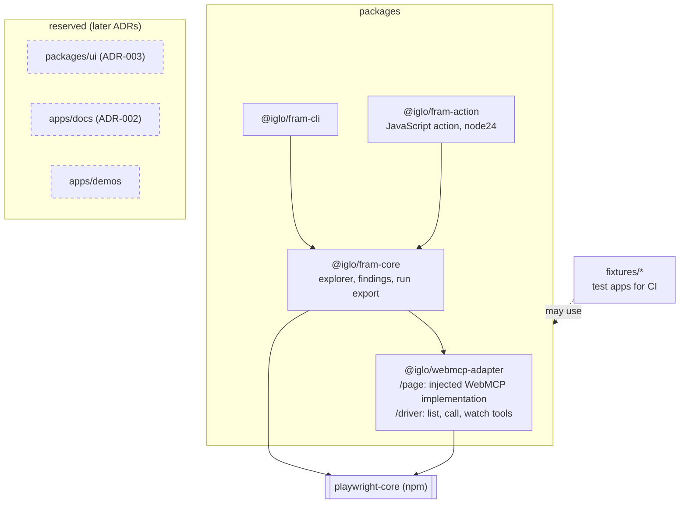

# Containers and packages

Source: [ADR-001](adr/001-repo-structure.md). Arrows are the only allowed workspace dependencies. dependency-cruiser enforces them in CI. Dashed boxes are reserved and do not exist yet.

Release path of the Action: `main` (source only) → release workflow (esbuild + `pnpm deploy --prod`) → branch `release/fram-action` → tags `fram-action-vX.Y.Z` and `fram-action-vX`.
