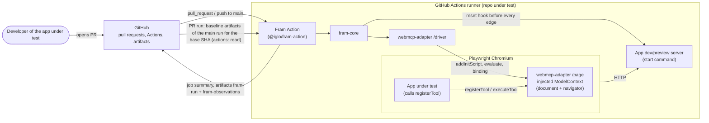

# System context

Source: [ADR-004](adr/004-webmcp-adapter.md), [ADR-007](adr/007-fram-mvp.md) and the Fram MVP scope in [IGL-40](/IGL/issues/IGL-40). The MVP has no Iglo backend: everything runs inside the CI runner of the repo under test.

Not in the MVP: Iglo-hosted services (ADR-005), dashboards, LLMs.
