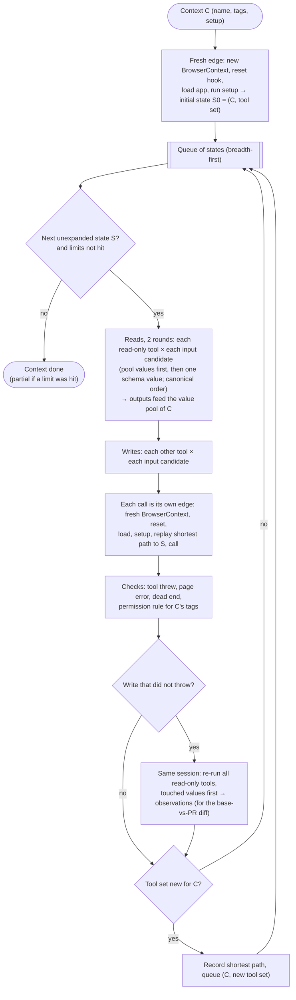

# Fram exploration loop

Source: [ADR-007](adr/007-fram-mvp.md), section 1. One loop per declared context. Contexts are explored one after another in the MVP, in canonical order of their names.

The value pool belongs to one context, and a pooled value is used only in edges whose path starts with the path that produced it; values from a write stay in that session. Finding IDs are computed from (type, tool, signature) only, never from the context, path, input or order (ADR-007, section 4).
